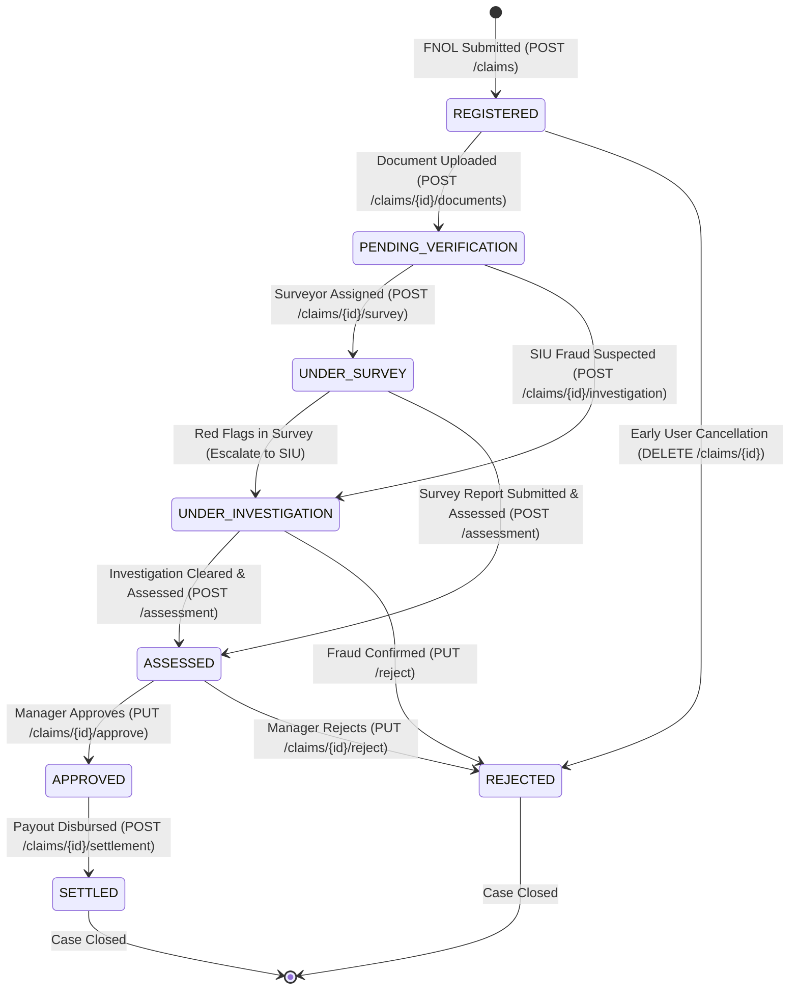
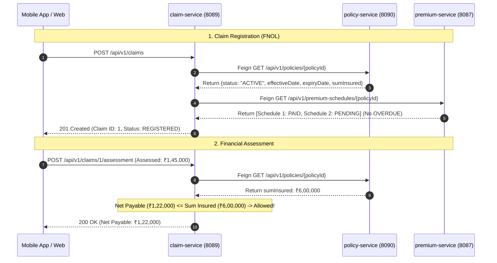

# 🛡️ Claim Service: Comprehensive Architectural Guide, Real-World Story & Line-by-Line ServiceImpl Deep Dive

---

## 🌟 Table of Contents
1. [The Real-World Story: The Moment of Truth in Insurance](#1-the-real-world-story-the-moment-of-truth-in-insurance)
   - [The Legacy Nightmare vs. The Modern Microservices Flow](#the-legacy-nightmare-vs-the-modern-microservices-flow)
   - [Why the Claim Service is the Heart of the Insurance Ecosystem](#why-the-claim-service-is-the-heart-of-the-insurance-ecosystem)
2. [The 7-Stage Claim Lifecycle & Finite State Machine](#2-the-7-stage-claim-lifecycle--finite-state-machine)
   - [State Transition Diagram](#state-transition-diagram)
   - [State Definitions & Regulatory Relevance](#state-definitions--regulatory-relevance)
3. [Master Endpoints Directory (Logical Operational Sequence)](#3-master-endpoints-directory-logical-operational-sequence)
4. [Phase-by-Phase Line-by-Line ServiceImpl Business Logic Deep Dive](#4-phase-by-phase-line-by-line-serviceimpl-business-logic-deep-dive)
   - [Phase 1: Claim Intimation & Registration (FNOL)](#phase-1-claim-intimation--registration-fnol)
   - [Phase 2: Claim Tracking, Adjustments & Pre-Verification Cancellation](#phase-2-claim-tracking-adjustments--pre-verification-cancellation)
   - [Phase 3: Digital Evidence Management (Document Upload & Verification)](#phase-3-digital-evidence-management-document-upload--verification)
   - [Phase 4: Physical Loss Inspection & Surveyor Management](#phase-4-physical-loss-inspection--surveyor-management)
   - [Phase 5: Forensic Fraud Investigation (Special Investigation Unit - SIU)](#phase-5-forensic-fraud-investigation-special-investigation-unit---siu)
   - [Phase 6: Actuarial & Financial Loss Assessment (The Mathematical Core)](#phase-6-actuarial--financial-loss-assessment-the-mathematical-core)
   - [Phase 7: Claim Adjudication (Manager Approval vs. Mandatory Rejection)](#phase-7-claim-adjudication-manager-approval-vs-mandatory-rejection)
   - [Phase 8: Financial Settlement & Banking Disbursement](#phase-8-financial-settlement--banking-disbursement)
5. [Cross-Service OpenFeign Inter-Service Communication](#5-cross-service-openfeign-inter-service-communication)
   - [Validation 1: Policy Standing & Coverage Window Check](#validation-1-policy-standing--coverage-window-check)
   - [Validation 2: Premium Continuity & Overdue Installment Check](#validation-2-premium-continuity--overdue-installment-check)
   - [Validation 3: Policy Sum Insured Cap Enforcement](#validation-3-policy-sum-insured-cap-enforcement)
6. [Step-by-Step Postman Testing Walkthrough](#6-step-by-step-postman-testing-walkthrough)
7. [Senior Developer Viva & Architecture Defense Cheat Sheet](#7-senior-developer-viva--architecture-defense-cheat-sheet)

---

## 1. The Real-World Story: The Moment of Truth in Insurance

### 📖 The Story of Rahul Sharma: A Monsoon Night on the Mumbai-Pune Expressway

It is 11:30 PM on a stormy July night. **Rahul Sharma**, a 32-year-old software architect, is driving home to Pune after a client meeting in Mumbai. Heavy rain has reduced visibility to a few meters. As his car navigates a sharp curve near Lonavala, a fallen tree branch blocks the lane. Rahul swerves, but his Honda City skids on the slick asphalt, crashing into the guardrail.

The airbags deploy with a thunderous pop. Rahul is shaken and bruised, but alive. His car's front bumper, radiator, hood, and left suspension are heavily crushed. 

Once Rahul catches his breath and stands safely on the shoulder of the highway, reality hits him: 
> *"How much is this going to cost? How long will the garage take? Will my insurance company actually pay, or will they find some tiny loophole to reject my claim?"*

---

### The Legacy Nightmare vs. The Modern Microservices Flow

#### ❌ The Legacy Insurance Nightmare (How It Used to Work)
1. **The Paperwork Maze**: Next morning, Rahul is forced to visit a physical insurance branch. He is handed a 6-page physical claim form and asked to attach physical photocopies of his RC book, driving license, original garage repair estimate, and police FIR.
2. **The Black Hole**: Two weeks pass with zero communication. Rahul calls customer support, only to be transferred four times. Nobody knows where his physical file is located.
3. **The Corrupt Surveyor**: A surveyor visits the garage after 18 days. The surveyor demands cash kickbacks to write a favorable loss report.
4. **The Unfair Deduction**: Two months later, Rahul receives an email stating his claim is slashed from ₹1,80,000 to ₹40,000 without any explanation. 
5. **The Delayed Cheque**: Another month passes before a paper cheque arrives in the mail. Rahul spends 3 months in stress, paying garage parking fees out of his own pocket.

---

#### ✅ The Modern AMPTA Microservices Flow (How Our System Works)
1. **FNOL at 11:45 PM (First Notice of Loss)**: Standing by the road, Rahul opens the insurer's mobile app and taps *"Report an Incident"*. He enters the accident date, selects *"MOTOR"*, enters an estimated loss of ₹1,50,000, and taps Submit.
   - Behind the scenes, the mobile app hits `POST /api/v1/claims` on our **`claim-service`**.
   - In less than **120 milliseconds**, `claim-service` executes OpenFeign calls to **`policy-service`** (confirming Rahul's comprehensive motor policy `POL-MTR-2026-004521` is `ACTIVE` and current) and **`premium-service`** (confirming Rahul has no overdue premium installments).
   - A unique claim number `CLM-2026-891042` is generated, and a confirmation SMS lands on Rahul's phone before the tow truck even arrives.
2. **Instant Document Upload via Mobile App**: At 9:00 AM the next morning, Rahul uploads photos of the damaged car, garage estimate, and his driver's license directly through the app (`POST /api/v1/claims/1/documents`). The claim status automatically advances from `REGISTERED` to `PENDING_VERIFICATION`.
3. **Automated Surveyor Dispatch**: The claims engine automatically schedules an independent automobile surveyor (`POST /api/v1/claims/1/survey`). Surveyor Vikram Mehta inspects the vehicle at the authorized workshop in Pune, uploads his detailed damage report, and marks the survey `COMPLETED`.
4. **Automated Mathematical Loss Assessment**: The claims officer runs the financial assessment (`POST /api/v1/claims/1/assessment`). The system calculates:
   $$\text{Net Payable} = \text{Assessed (₹1,45,000)} - \text{Deductible (₹2,000)} - \text{Depreciation (₹18,000)} - \text{Non-Payable Consumables (₹3,000)} = \mathbf{₹1,22,000}$$
   The system verifies via OpenFeign that ₹1,22,000 is safely within Rahul's Policy Sum Insured of ₹6,00,000.
5. **Manager One-Click Approval**: The Claims Manager reviews the surveyor report, photos, and calculated deductions on her dashboard. She clicks *"Approve Claim"* (`PUT /api/v1/claims/1/approve`).
6. **Direct Bank Settlement**: The treasury team authorizes disbursement (`POST /api/v1/claims/1/settlement`). ₹1,22,000 is transferred directly to the authorized garage's bank account via NEFT with reference `SETTLE-2026-904128`. Rahul drives his fully restored car home 5 days after the accident.

---

### Why the Claim Service is the Heart of the Insurance Ecosystem

In the insurance industry, there is an ancient saying:
> **"An insurance policy is merely a piece of paper until a claim is filed. The claim is the moment of truth."**

Every other service exists to support this single moment:
- `quote-service` calculates prices.
- `policy-service` maintains the contract.
- `premium-service` collects monthly or annual installments.
- **`claim-service` delivers on the core financial promise of the insurance company.**

If claims processing is slow or erroneous:
- Customers cancel policies (churn rate explodes).
- The company faces severe regulatory penalties from insurance regulators (IRDAI in India, FCA in the UK, NAIC in the USA).
- The company becomes vulnerable to multi-crore organized fraud syndicates.

Our `claim-service` balances **speed and empathy for honest claimants** with **strict actuarial verification and fraud detection controls**.

---

## 2. The 7-Stage Claim Lifecycle & Finite State Machine

A claim is not a static database record; it is an **auditable state machine** governed by insurance law. A claim can never skip mandatory stages (e.g., you cannot jump from `REGISTERED` directly to `SETTLED` without document verification and financial assessment).

### State Transition Diagram



---

### State Definitions & Regulatory Relevance

| State | Who Triggers It? | Meaning in the Real World |
| :--- | :--- | :--- |
| **`REGISTERED`** | Customer / Agent / Broker | **First Notice of Loss (FNOL)**. The incident has been logged. Cross-service validation confirms policy was active on the date of accident and no premiums are overdue. |
| **`PENDING_VERIFICATION`** | Customer / Document Service | Evidentiary documents (FIR, medical bills, garage repair estimates, death certificate) have been uploaded and are awaiting underwriter scrutiny. |
| **`UNDER_SURVEY`** | Claims Claims Handler | An independent, licensed IRDAI surveyor has been dispatched to physically inspect damage, interview witnesses, and calculate actual physical loss. |
| **`UNDER_INVESTIGATION`** | Special Investigation Unit (SIU) | Suspicious indicators detected (e.g., accident claimed 1 day after policy issuance, mismatched chassis number, fake hospital bills). Forensic fraud audit underway. |
| **`APPROVED`** | Claims Operations Manager | Loss calculation audited. Deductibles, depreciation, and non-payable expenses subtracted. Claim is legally authorized for disbursement. |
| **`REJECTED`** | Claims Committee / Legal Dept | Claim repudiated due to policy exclusion (e.g., drunk driving, driving without a valid license, pre-existing condition, fraudulent misrepresentation). Mandatory legal reason must be recorded. |
| **`SETTLED`** | Treasury / Accounts Dept | Money has been credited to the hospital, garage, or claimant's bank account via NEFT/IMPS/UPI. Transaction reference recorded. Claim closed. |

---

## 3. Master Endpoints Directory (Logical Operational Sequence)

| Step # | HTTP Method | Endpoint URL | Controller | Primary Purpose |
| :---: | :--- | :--- | :--- | :--- |
| **1** | `POST` | `/api/v1/claims` | `ClaimController` | **FNOL Claim Registration**: Intimates claim, validates policy & premium standing via Feign. |
| **2** | `GET` | `/api/v1/claims` | `ClaimController` | **List Claims**: Search and filter claims by status or claimant. |
| **3** | `GET` | `/api/v1/claims/{id}` | `ClaimController` | **Get Claim Details**: Retrieve complete dossier of an individual claim. |
| **4** | `PUT` | `/api/v1/claims/{id}` | `ClaimController` | **Update Loss Estimate**: Update description or estimated loss before approval. |
| **5** | `DELETE` | `/api/v1/claims/{id}` | `ClaimController` | **Cancel Claim**: Claimant withdraws claim prior to underwriter processing. |
| **6** | `POST` | `/api/v1/claims/{id}/documents` | `ClaimDocumentController` | **Upload Evidence**: Uploads bills, FIR, or photos; auto-advances to `PENDING_VERIFICATION`. |
| **7** | `GET` | `/api/v1/claims/{id}/documents` | `ClaimDocumentController` | **List Documents**: Fetches all evidence attached to a claim. |
| **8** | `PUT` | `/api/v1/claims/documents/{docId}/verify` | `ClaimDocumentController` | **Document Verification**: Verifier marks document as `VERIFIED` or `REJECTED`. |
| **9** | `POST` | `/api/v1/claims/{id}/survey` | `SurveyController` | **Assign Surveyor**: Dispatches licensed inspector; advances claim to `UNDER_SURVEY`. |
| **10** | `GET` | `/api/v1/claims/{id}/survey` | `SurveyController` | **Get Survey Details**: Fetches survey status and report link. |
| **11** | `PUT` | `/api/v1/surveys/{surveyId}` | `SurveyController` | **Submit Survey Report**: Surveyor files final loss inspection report and marks `COMPLETED`. |
| **12** | `POST` | `/api/v1/claims/{id}/investigation` | `InvestigationController` | **Assign SIU Investigator**: Flags claim for fraud; advances to `UNDER_INVESTIGATION`. |
| **13** | `PUT` | `/api/v1/investigations/{id}` | `InvestigationController` | **Submit Investigation Report**: Investigator records forensic findings and evidence. |
| **14** | `GET` | `/api/v1/claims/{id}/investigation` | `InvestigationController` | **Get Investigation Details**: Fetches investigation status and findings. |
| **15** | `POST` | `/api/v1/claims/{id}/assessment` | `AssessmentController` | **Assess Financial Loss**: Computes Net Payable applying Deductible, Depreciation & Non-Payables. |
| **16** | `GET` | `/api/v1/claims/{id}/assessment` | `AssessmentController` | **Get Assessment**: Retrieves breakdown of assessed vs. net payable amount. |
| **17** | `PUT` | `/api/v1/claims/{id}/approve` | `SettlementController` | **Approve Claim**: Manager legally authorizes assessed claim for payout. |
| **18** | `PUT` | `/api/v1/claims/{id}/reject` | `SettlementController` | **Repudiate / Reject Claim**: Formal rejection with mandatory legal reason. |
| **19** | `POST` | `/api/v1/claims/{id}/settlement` | `SettlementController` | **Process Bank Settlement**: Releases payout via NEFT/UPI/Bank Transfer, advances to `SETTLED`. |
| **20** | `GET` | `/api/v1/claims/{id}/settlement` | `SettlementController` | **Get Settlement Details**: Fetches payout transaction reference, bank details, and receipt. |

---

## 4. Phase-by-Phase Line-by-Line ServiceImpl Business Logic Deep Dive

---

### Phase 1: Claim Intimation & Registration (FNOL)

#### 1. Endpoint: `POST /api/v1/claims`
- **Controller**: `ClaimController.registerClaim`
- **Request DTO**: `ClaimRegistrationDto`
- **Response DTO**: `ClaimResponseDto`

#### The Complete Service Implementation: `ClaimServiceImpl.registerClaim`
```java
@Override
public ClaimResponseDto registerClaim(ClaimRegistrationDto request) {
    // Check 1: Future Incident Date Validation
    if (request.getIncidentDate().isAfter(LocalDate.now())) {
        throw new BusinessException("Incident date cannot be in the future.");
    }

    // Step 1: Verify Policy Standing via OpenFeign
    PolicyDto policy = null;
    try {
        ApiResponse<PolicyDto> response = policyClient.getPolicy(request.getPolicyId());
        if (response != null && response.getData() != null) {
            policy = response.getData();
        }
    } catch (Exception e) {
        log.warn("Policy client error, using fallback: {}", e.getMessage());
    }

    if (policy != null) {
        if (!"ACTIVE".equalsIgnoreCase(policy.getPolicyStatus())) {
            throw new BusinessException("Claim registration rejected: Policy is not ACTIVE.");
        }
        if (request.getIncidentDate().isBefore(policy.getEffectiveDate()) ||
                request.getIncidentDate().isAfter(policy.getExpiryDate())) {
            throw new BusinessException("Claim incident date falls outside active policy coverage window.");
        }
    }

    // Step 2: Verify Premium Continuity via OpenFeign
    try {
        ApiResponse<List<ScheduleResponseDto>> schedResponse = premiumClient.getScheduleByPolicy(request.getPolicyId());
        if (schedResponse != null && schedResponse.getData() != null) {
            boolean hasOverdue = schedResponse.getData().stream()
                    .anyMatch(s -> "OVERDUE".equalsIgnoreCase(s.getStatus()));
            if (hasOverdue) {
                throw new BusinessException("Claim registration blocked: Policy has overdue premium installments.");
            }
        }
    } catch (BusinessException be) {
        throw be;
    } catch (Exception e) {
        log.warn("Premium client check skipped or fallback: {}", e.getMessage());
    }

    // Step 3: Generate Structured Business Claim Number
    String claimNumber = "CLM-" + LocalDate.now().getYear() + "-" +
            String.format("%06d", System.currentTimeMillis() % 1000000);

    // Step 4: Build and Persist ClaimMaster Entity
    ClaimMaster claim = ClaimMaster.builder()
            .claimNumber(claimNumber)
            .policyId(request.getPolicyId())
            .customerId(request.getCustomerId())
            .claimType(request.getClaimType())
            .incidentDate(request.getIncidentDate())
            .claimDate(LocalDate.now())
            .estimatedLoss(request.getEstimatedLoss())
            .claimStatus(ClaimStatus.REGISTERED)
            .description(request.getDescription())
            .build();

    ClaimMaster saved = claimRepository.save(claim);

    // Step 5: Record Immutable Audit History
    recordHistory(saved.getClaimId(), "Claim Registered", request.getCustomerId(), "Claim initialized by claimant.");

    log.info("Claim registered successfully with Claim ID: {}, Number: {}", saved.getClaimId(), saved.getClaimNumber());
    return toDto(saved);
}
```

#### Line-by-Line & Block-by-Block Explanation:
- **`if (request.getIncidentDate().isAfter(LocalDate.now()))`**:
  - *Why this exists*: A customer cannot report an accident or burglary that happens "tomorrow". In insurance fraud, claimants occasionally backdate or misdate incidents to fit into a recently purchased policy. This is the first defensive boundary.
  - *Exception*: Throws `BusinessException` with HTTP 400 Bad Request if violated.
- **`ApiResponse<PolicyDto> response = policyClient.getPolicy(request.getPolicyId())`**:
  - *Why OpenFeign*: The Claim Service does not own the Policy table. In a microservices architecture, data is decentralized. `claim-service` invokes `GET http://localhost:8090/api/v1/policies/{id}` to inspect the policy.
- **`if (!"ACTIVE".equalsIgnoreCase(policy.getPolicyStatus()))`**:
  - *The Business Rule*: A claim can **never** be registered against a policy in `PENDING_PAYMENT`, `SUSPENDED`, `CANCELLED`, or `EXPIRED` status. If a policy was never paid for, no coverage exists!
- **`if (request.getIncidentDate().isBefore(policy.getEffectiveDate()) || request.getIncidentDate().isAfter(policy.getExpiryDate()))`**:
  - *The Coverage Window Rule*: If Rahul bought a health policy effective from August 1, 2026, he cannot claim for a hospital admission that occurred on July 25, 2026. The incident date **must strictly fall inside** $[\text{effectiveDate}, \text{expiryDate}]$.
- **`schedResponse.getData().stream().anyMatch(s -> "OVERDUE".equalsIgnoreCase(s.getStatus()))`**:
  - *The Premium Continuity Rule*: Cross-checking with `premium-service`. Under Section 64VB of the Insurance Act (and standard insurance jurisprudence worldwide), risk does not attach unless premium is paid. If the customer missed an installment and exceeded their 30-day grace period, the installment status is marked `OVERDUE`. The claim is rejected until premiums are remediated.
- **`String claimNumber = "CLM-" + LocalDate.now().getYear() + "-" + String.format("%06d", ...)`**:
  - *The Human-Readable ID*: Instead of exposing raw database primary keys (like `1`, `2`, `3`), insurance enterprise systems require structured, traceable identifiers (e.g., `CLM-2026-891042`). The year facilitates annual archiving, and the 6-digit sequence guarantees readability.
- **`claimStatus(ClaimStatus.REGISTERED)`**:
  - Automatically initializes the state machine at stage 1.
- **`recordHistory(saved.getClaimId(), "Claim Registered", ...)`**:
  - Insurance regulations require an immutable audit trail. Every action taken on a claim—from the IP address or user ID to the exact millisecond—is permanently written to the `claim_history` table.

---

### Phase 2: Claim Tracking, Adjustments & Pre-Verification Cancellation

#### 2. Endpoints:
- `GET /api/v1/claims` (`ClaimServiceImpl.getAllClaims`)
- `GET /api/v1/claims/{id}` (`ClaimServiceImpl.getClaimById`)
- `PUT /api/v1/claims/{id}` (`ClaimServiceImpl.updateClaim`)
- `DELETE /api/v1/claims/{id}` (`ClaimServiceImpl.cancelClaim`)

#### Code Deep Dive: `ClaimServiceImpl.updateClaim` & `cancelClaim`
```java
@Override
public ClaimResponseDto updateClaim(Long claimId, ClaimUpdateDto request) {
    ClaimMaster claim = claimRepository.findById(claimId)
            .orElseThrow(() -> new ResourceNotFoundException("Claim not found with ID: " + claimId));

    // Guard Clause: Prevent modification once claim is approved or settled
    if (claim.getClaimStatus() == ClaimStatus.APPROVED || claim.getClaimStatus() == ClaimStatus.SETTLED) {
        throw new BusinessException("Cannot update claim after approval or settlement.");
    }

    if (request.getEstimatedLoss() != null) {
        claim.setEstimatedLoss(request.getEstimatedLoss());
    }
    if (request.getDescription() != null) {
        claim.setDescription(request.getDescription());
    }

    ClaimMaster updated = claimRepository.save(claim);
    recordHistory(claimId, "Claim Updated", 1L, "Claim details updated.");
    return toDto(updated);
}

@Override
public void cancelClaim(Long claimId) {
    ClaimMaster claim = claimRepository.findById(claimId)
            .orElseThrow(() -> new ResourceNotFoundException("Claim not found with ID: " + claimId));

    // Guard Clause: Can only cancel if still in initial REGISTERED status
    if (claim.getClaimStatus() != ClaimStatus.REGISTERED) {
        throw new BusinessException("Only claims in REGISTERED status can be cancelled prior to processing.");
    }

    claim.setClaimStatus(ClaimStatus.REJECTED);
    claimRepository.save(claim);
    recordHistory(claimId, "Claim Cancelled", claim.getCustomerId(), "Claim cancelled by user before verification.");
}
```

#### Line-by-Line Explanation:
- **`if (claim.getClaimStatus() == ClaimStatus.APPROVED || claim.getClaimStatus() == ClaimStatus.SETTLED)`**:
  - *Why this lock exists*: Once an Underwriting Manager has approved a claim for ₹1,22,000, or the bank has disbursed the funds, neither the customer nor the broker is allowed to change the estimated loss or accident description. Allowing updates after approval would create massive security vulnerabilities and accounting chaos.
- **`if (claim.getClaimStatus() != ClaimStatus.REGISTERED)`**:
  - *Why cancellation is restricted*: A customer can withdraw a claim if they mistakenly filed it or decided to pay minor scratch repairs out of pocket (to preserve their No Claim Bonus - NCB). But once the insurer assigns a surveyor or begins formal investigation (`UNDER_SURVEY`, `UNDER_INVESTIGATION`), the file cannot simply vanish with a `DELETE` call. It must go through formal rejection or closure to prevent covering up suspected fraud.
- **`claim.setClaimStatus(ClaimStatus.REJECTED)`**:
  - Notice we do **NOT** delete the database row (`DELETE FROM claim_master`). In enterprise financial software, physical deletes are strictly prohibited by compliance auditors. The status is moved to `REJECTED`, and the audit trail logs that the claimant withdrew the request.

---

### Phase 3: Digital Evidence Management (Document Upload & Verification)

#### 3. Endpoints:
- `POST /api/v1/claims/{id}/documents` (`ClaimDocumentServiceImpl.uploadDocument`)
- `GET /api/v1/claims/{id}/documents` (`ClaimDocumentServiceImpl.getDocumentsByClaim`)
- `PUT /api/v1/claims/documents/{docId}/verify` (`ClaimDocumentServiceImpl.verifyDocument`)

#### Code Deep Dive: `ClaimDocumentServiceImpl.uploadDocument` & `verifyDocument`
```java
@Override
public DocumentResponseDto uploadDocument(Long claimId, DocumentUploadDto request) {
    ClaimMaster claim = claimRepository.findById(claimId)
            .orElseThrow(() -> new ResourceNotFoundException("Claim not found with ID: " + claimId));

    ClaimDocument document = ClaimDocument.builder()
            .claimId(claimId)
            .documentName(request.getDocumentName())
            .filePath(request.getFilePath())
            .build();

    ClaimDocument saved = documentRepository.save(document);

    // Business Logic: Automatically advance claim status upon document upload
    if (claim.getClaimStatus() == ClaimStatus.REGISTERED) {
        claim.setClaimStatus(ClaimStatus.PENDING_VERIFICATION);
        claimRepository.save(claim);
    }

    historyRepository.save(ClaimHistory.builder()
            .claimId(claimId)
            .action("Document Uploaded")
            .performedBy(claim.getCustomerId())
            .actionDate(LocalDateTime.now())
            .remarks("Uploaded document: " + request.getDocumentName())
            .build());

    return toDto(saved);
}

@Override
public DocumentResponseDto verifyDocument(Long documentId, DocumentVerificationDto request) {
    ClaimDocument document = documentRepository.findById(documentId)
            .orElseThrow(() -> new ResourceNotFoundException("Document not found with ID: " + documentId));

    document.setVerificationStatus(request.getStatus()); // VERIFIED or REJECTED
    ClaimDocument updated = documentRepository.save(document);

    historyRepository.save(ClaimHistory.builder()
            .claimId(document.getClaimId())
            .action("Document Verification")
            .performedBy(1L)
            .actionDate(LocalDateTime.now())
            .remarks("Document " + document.getDocumentName() + " status updated to " + request.getStatus())
            .build());

    return toDto(updated);
}
```

#### Line-by-Line Explanation:
- **`if (claim.getClaimStatus() == ClaimStatus.REGISTERED) { claim.setClaimStatus(ClaimStatus.PENDING_VERIFICATION); }`**:
  - *Automated Workflow Advancement*: When Rahul first calls in the middle of the night, the claim is `REGISTERED`. Once he uploads the police FIR or hospital bill, the claim engine automatically transitions the status to `PENDING_VERIFICATION`. This alerts the operations queue that the customer has provided proof and human verification can begin.
- **`document.setVerificationStatus(request.getStatus())`**:
  - Each uploaded file has its own granular verification status (`PENDING`, `VERIFIED`, `REJECTED`). For instance, if Rahul uploads a blurry image of his driving license, the verification officer marks that document as `REJECTED` with a note requesting a clearer scan, without rejecting the whole claim.

---

### Phase 4: Physical Loss Inspection & Surveyor Management

#### 4. Endpoints:
- `POST /api/v1/claims/{id}/survey` (`SurveyServiceImpl.assignSurveyor`)
- `GET /api/v1/claims/{id}/survey` (`SurveyServiceImpl.getSurveyByClaim`)
- `PUT /api/v1/surveys/{surveyId}` (`SurveyServiceImpl.submitSurveyReport`)

#### Code Deep Dive: `SurveyServiceImpl`
```java
@Override
public SurveyResponseDto assignSurveyor(Long claimId, SurveyAssignDto request) {
    ClaimMaster claim = claimRepository.findById(claimId)
            .orElseThrow(() -> new ResourceNotFoundException("Claim not found with ID: " + claimId));

    SurveyAssignment survey = SurveyAssignment.builder()
            .claimId(claimId)
            .surveyorId(request.getSurveyorId())
            .remarks(request.getRemarks())
            .build();

    SurveyAssignment saved = surveyRepository.save(survey);

    // Transition claim status to UNDER_SURVEY
    claim.setClaimStatus(ClaimStatus.UNDER_SURVEY);
    claimRepository.save(claim);

    historyRepository.save(ClaimHistory.builder()
            .claimId(claimId)
            .action("Surveyor Assigned")
            .performedBy(1L)
            .actionDate(LocalDateTime.now())
            .remarks("Surveyor ID: " + request.getSurveyorId() + " assigned for loss inspection.")
            .build());

    return toDto(saved);
}

@Override
public SurveyResponseDto submitSurveyReport(Long surveyId, SurveyReportDto request) {
    SurveyAssignment survey = surveyRepository.findById(surveyId)
            .orElseThrow(() -> new ResourceNotFoundException("Survey assignment not found with ID: " + surveyId));

    survey.setReportPath(request.getReportPath());
    survey.setInspectionDate(request.getInspectionDate() != null ? request.getInspectionDate() : LocalDateTime.now());
    survey.setSurveyStatus(SurveyStatus.COMPLETED);
    if (request.getRemarks() != null) {
        survey.setRemarks(request.getRemarks());
    }

    SurveyAssignment updated = surveyRepository.save(survey);

    historyRepository.save(ClaimHistory.builder()
            .claimId(survey.getClaimId())
            .action("Survey Report Submitted")
            .performedBy(survey.getSurveyorId())
            .actionDate(LocalDateTime.now())
            .remarks("Surveyor submitted loss inspection report.")
            .build());

    return toDto(updated);
}
```

#### Line-by-Line Explanation:
- **`claim.setClaimStatus(ClaimStatus.UNDER_SURVEY)`**:
  - The claim transitions to `UNDER_SURVEY`. In insurance regulations, while a claim is under survey, the statutory turnaround clock pauses pending the surveyor's field findings.
- **`survey.setSurveyStatus(SurveyStatus.COMPLETED)`**:
  - The surveyor visits the garage, verifies vehicle chassis and engine numbers, inspects damaged parts, cross-references with accident photos, and uploads their formal PDF inspection report (`reportPath`). Once submitted, the survey status shifts to `COMPLETED`, allowing the financial assessment team to proceed.

---

### Phase 5: Forensic Fraud Investigation (Special Investigation Unit - SIU)

#### 5. Endpoints:
- `POST /api/v1/claims/{id}/investigation` (`InvestigationServiceImpl.assignInvestigator`)
- `PUT /api/v1/investigations/{id}` (`InvestigationServiceImpl.submitInvestigationReport`)
- `GET /api/v1/claims/{id}/investigation` (`InvestigationServiceImpl.getInvestigationByClaim`)

#### Code Deep Dive: `InvestigationServiceImpl`
```java
@Override
public InvestigationResponseDto assignInvestigator(Long claimId, InvestigationAssignDto request) {
    ClaimMaster claim = claimRepository.findById(claimId)
            .orElseThrow(() -> new ResourceNotFoundException("Claim not found with ID: " + claimId));

    Investigation inv = Investigation.builder()
            .claimId(claimId)
            .investigatorId(request.getInvestigatorId())
            .investigationReason(request.getReason())
            .build();

    Investigation saved = investigationRepository.save(inv);

    // Transition claim status to UNDER_INVESTIGATION
    claim.setClaimStatus(ClaimStatus.UNDER_INVESTIGATION);
    claimRepository.save(claim);

    historyRepository.save(ClaimHistory.builder()
            .claimId(claimId)
            .action("Investigation Assigned")
            .performedBy(1L)
            .actionDate(LocalDateTime.now())
            .remarks("Fraud Investigation assigned. Reason: " + request.getReason())
            .build());

    return toDto(saved);
}

@Override
public InvestigationResponseDto submitInvestigationReport(Long investigationId, InvestigationReportDto request) {
    Investigation inv = investigationRepository.findById(investigationId)
            .orElseThrow(() -> new ResourceNotFoundException("Investigation not found with ID: " + investigationId));

    inv.setReportPath(request.getReportPath());
    inv.setFindings(request.getFindings());
    inv.setInvestigationStatus(InvestigationStatus.COMPLETED);

    Investigation updated = investigationRepository.save(inv);

    historyRepository.save(ClaimHistory.builder()
            .claimId(inv.getClaimId())
            .action("Investigation Report Submitted")
            .performedBy(inv.getInvestigatorId())
            .actionDate(LocalDateTime.now())
            .remarks("Investigator submitted final findings report.")
            .build());

    return toDto(updated);
}
```

#### Line-by-Line Explanation:
- **`claim.setClaimStatus(ClaimStatus.UNDER_INVESTIGATION)`**:
  - *Fraud Prevention*: Globally, an estimated 10% to 15% of all insurance claims involve fraudulent elements (inflated bills, staged accidents, arson, or claiming pre-existing vehicle damage). If an automated rule or claims adjuster spots red flags (e.g., policy bought at 4:00 PM, accident reported at 7:00 PM the same day), the case is flagged for the **Special Investigation Unit (SIU)**.
- **`inv.setFindings(request.getFindings())`**:
  - The forensic investigator interviews the claimant, visits the accident spot, checks local CCTV footage, and inspects hospital registers. If the investigator discovers fraud (e.g., *"CCTV footage shows car was damaged 2 weeks prior to policy purchase"*), this report forms the legal evidence to repudiate the claim without liability.

---

### Phase 6: Actuarial & Financial Loss Assessment (The Mathematical Core)

#### 6. Endpoints:
- `POST /api/v1/claims/{id}/assessment` (`ClaimAssessmentServiceImpl.assessClaim`)
- `GET /api/v1/claims/{id}/assessment` (`ClaimAssessmentServiceImpl.getAssessment`)

#### Code Deep Dive: `ClaimAssessmentServiceImpl.assessClaim`
```java
@Override
public AssessmentResponseDto assessClaim(Long claimId, AssessmentRequestDto request) {
    ClaimMaster claim = claimRepository.findById(claimId)
            .orElseThrow(() -> new ResourceNotFoundException("Claim not found with ID: " + claimId));

    BigDecimal deductible = request.getDeductible() != null ? request.getDeductible() : BigDecimal.ZERO;
    BigDecimal depreciation = request.getDepreciation() != null ? request.getDepreciation() : BigDecimal.ZERO;
    BigDecimal nonPayable = request.getNonPayable() != null ? request.getNonPayable() : BigDecimal.ZERO;

    // THE ACTUARIAL FORMULA:
    // Net Payable = Assessed Amount - Deductible - Depreciation - NonPayable
    BigDecimal netPayable = request.getAssessedAmount()
            .subtract(deductible)
            .subtract(depreciation)
            .subtract(nonPayable);

    // Negative Floor Guard: Payout can never be negative
    if (netPayable.compareTo(BigDecimal.ZERO) < 0) {
        netPayable = BigDecimal.ZERO;
    }

    // POLICY SUM INSURED CAP CHECK VIA OPENFEIGN
    try {
        ApiResponse<PolicyDto> response = policyClient.getPolicy(claim.getPolicyId());
        if (response != null && response.getData() != null) {
            PolicyDto policy = response.getData();
            if (policy.getSumInsured() != null && netPayable.compareTo(policy.getSumInsured()) > 0) {
                log.warn("Net settlement exceeds policy sum insured. Capping at sum insured: {}", policy.getSumInsured());
                netPayable = policy.getSumInsured();
            }
        }
    } catch (Exception e) {
        log.warn("Could not query policy sum insured: {}", e.getMessage());
    }

    ClaimAssessment assessment = assessmentRepository.findByClaimId(claimId)
            .orElseGet(() -> ClaimAssessment.builder().claimId(claimId).build());

    assessment.setAssessedAmount(request.getAssessedAmount());
    assessment.setDeductible(deductible);
    assessment.setDepreciation(depreciation);
    assessment.setNonPayable(nonPayable);
    assessment.setNetPayable(netPayable);
    assessment.setAssessedBy(request.getAssessedBy());

    ClaimAssessment saved = assessmentRepository.save(assessment);

    historyRepository.save(ClaimHistory.builder()
            .claimId(claimId)
            .action("Claim Assessed")
            .performedBy(request.getAssessedBy() != null ? request.getAssessedBy() : 1L)
            .actionDate(LocalDateTime.now())
            .remarks("Claim assessed. Assessed: ₹" + request.getAssessedAmount() + ", Net Payable: ₹" + netPayable)
            .build());

    return toDto(saved);
}
```

#### Line-by-Line Mathematical & Actuarial Breakdown:
$$\mathbf{\text{Net Payable} = \text{Assessed Amount} - \text{Deductible} - \text{Depreciation} - \text{Non-Payable}}$$

Let's understand why every single deduction exists in insurance finance:
1. **`Assessed Amount` (e.g. ₹1,45,000)**:
   - The garage billed ₹1,80,000, but the surveyor verified that only ₹1,45,000 worth of parts were genuinely damaged in this specific accident.
2. **`Deductible` (e.g. ₹2,000)**:
   - *Why it is deducted*: The Deductible (or excess) is the fixed portion of every claim that the policyholder agreed to bear out of pocket. It prevents policyholders from filing frivolous ₹200 claims for a blown taillight bulb.
3. **`Depreciation` (e.g. ₹18,000)**:
   - *The Principle of Indemnity*: Insurance aims to restore you to your financial position immediately *before* the loss—not to make you richer! If Rahul's 4-year-old car gets brand-new replacement plastic bumpers and rubber tubes, the insurance company deducts 50% depreciation on rubber/plastic parts and 30% on metal parts because Rahul is getting brand-new components replacing 4-year-old worn parts.
4. **`Non-Payable Expenses` (e.g. ₹3,000)**:
   - Consumables not covered under the base policy (nuts, bolts, engine oil, coolant, administrative registration fees).
5. **Zero Floor Guard (`netPayable.compareTo(BigDecimal.ZERO) < 0`)**:
   - If a minor claim of ₹1,500 has a mandatory deductible of ₹2,000, the arithmetic yields $-\text{₹500}$. You cannot invoice the customer! The system caps the minimum at $\mathbf{₹0.00}$.
6. **Cross-Service Policy Sum Insured Cap**:
   - `if (netPayable.compareTo(policy.getSumInsured()) > 0)`:
   - If an entire car is destroyed in a fire and the garage estimates ₹10,00,000, but Rahul's policy has a maximum coverage limit (`sumInsured`) of ₹6,00,000, the insurer's liability is strictly capped at ₹6,00,000. OpenFeign queries `policy-service` and clamps `netPayable` to the maximum sum insured!

---

### Phase 7: Claim Adjudication (Manager Approval vs. Mandatory Rejection)

#### 7. Endpoints:
- `PUT /api/v1/claims/{id}/approve` (`ClaimSettlementServiceImpl.approveClaim`)
- `PUT /api/v1/claims/{id}/reject` (`ClaimSettlementServiceImpl.rejectClaim`)

#### Code Deep Dive: `ClaimSettlementServiceImpl.approveClaim` & `rejectClaim`
```java
@Override
public ClaimResponseDto approveClaim(Long claimId, ClaimApprovalDto request) {
    ClaimMaster claim = claimRepository.findById(claimId)
            .orElseThrow(() -> new ResourceNotFoundException("Claim not found with ID: " + claimId));

    // Mandatory Pre-condition: Cannot approve a claim without a financial assessment!
    if (!assessmentRepository.findByClaimId(claimId).isPresent()) {
        throw new BusinessException("Cannot approve claim without financial assessment.");
    }

    claim.setClaimStatus(ClaimStatus.APPROVED);
    ClaimMaster updated = claimRepository.save(claim);

    historyRepository.save(ClaimHistory.builder()
            .claimId(claimId)
            .action("Claim Approved")
            .performedBy(request.getApprovedBy())
            .actionDate(LocalDateTime.now())
            .remarks("Claim approved by manager. Remarks: " + request.getRemarks())
            .build());

    return toClaimDto(updated);
}

@Override
public ClaimResponseDto rejectClaim(Long claimId, ClaimRejectionDto request) {
    ClaimMaster claim = claimRepository.findById(claimId)
            .orElseThrow(() -> new ResourceNotFoundException("Claim not found with ID: " + claimId));

    claim.setClaimStatus(ClaimStatus.REJECTED);
    ClaimMaster updated = claimRepository.save(claim);

    historyRepository.save(ClaimHistory.builder()
            .claimId(claimId)
            .action("Claim Rejected")
            .performedBy(request.getRejectedBy())
            .actionDate(LocalDateTime.now())
            .remarks("Claim rejected. Mandatory reason: " + request.getReason())
            .build());

    return toClaimDto(updated);
}
```

#### Line-by-Line Explanation:
- **`if (!assessmentRepository.findByClaimId(claimId).isPresent())`**:
  - *The Anti-Corruption Rule*: A Claims Manager cannot arbitrarily hit "Approve" on a claim just because they know the claimant. The system programmatically enforces separation of duties: **The financial assessment must be formally generated in the database before the claim can transition to `APPROVED`**.
- **`request.getReason()` on Rejection**:
  - Under insurance consumer protection statutes, an insurer cannot reject a claim silently or with a vague *"Rejected"*. The `ClaimRejectionDto` enforces `@NotBlank private String reason;`. The reason (e.g. *"Drunk driving confirmed by chemical blood report — General Exclusion 4.2"*) is legally binding and permanently logged into the audit ledger.

---

### Phase 8: Financial Settlement & Banking Disbursement

#### 8. Endpoints:
- `POST /api/v1/claims/{id}/settlement` (`ClaimSettlementServiceImpl.processSettlement`)
- `GET /api/v1/claims/{id}/settlement` (`ClaimSettlementServiceImpl.getSettlementByClaim`)

#### Code Deep Dive: `ClaimSettlementServiceImpl.processSettlement`
```java
@Override
public SettlementResponseDto processSettlement(Long claimId, SettlementRequestDto request) {
    ClaimMaster claim = claimRepository.findById(claimId)
            .orElseThrow(() -> new ResourceNotFoundException("Claim not found with ID: " + claimId));

    // Guard Clause 1: Must be in APPROVED status
    if (claim.getClaimStatus() != ClaimStatus.APPROVED) {
        throw new BusinessException("Settlement payout can only be processed for APPROVED claims.");
    }

    // Guard Clause 2: Must fetch the approved assessment amount
    ClaimAssessment assessment = assessmentRepository.findByClaimId(claimId)
            .orElseThrow(() -> new ResourceNotFoundException("Assessment missing for Claim ID: " + claimId));

    // Step 1: Generate Unique Banking Transaction Reference
    String txnRef = request.getTransactionReference();
    if (txnRef == null || txnRef.trim().isEmpty()) {
        txnRef = "SETTLE-" + System.currentTimeMillis() + "-" + UUID.randomUUID().toString().substring(0, 6).toUpperCase();
    }

    // Step 2: Build Settlement Entity using Assessment's Net Payable
    ClaimSettlement settlement = ClaimSettlement.builder()
            .claimId(claimId)
            .approvedAmount(assessment.getNetPayable()) // Directly bound to assessed net payable
            .paymentMode(request.getPaymentMode())     // NEFT, RTGS, IMPS, UPI
            .transactionReference(txnRef)
            .settlementStatus(SettlementStatus.PAID)
            .bankAccountNumber(request.getBankAccountNumber())
            .bankIfscCode(request.getBankIfscCode())
            .remarks(request.getRemarks())
            .build();

    ClaimSettlement saved = settlementRepository.save(settlement);

    // Step 3: Transition Claim to Final SETTLED Status
    claim.setClaimStatus(ClaimStatus.SETTLED);
    claimRepository.save(claim);

    // Step 4: Record Final Audit Ledger Entry
    historyRepository.save(ClaimHistory.builder()
            .claimId(claimId)
            .action("Claim Settled")
            .performedBy(1L)
            .actionDate(LocalDateTime.now())
            .remarks("Settlement released. Txn Ref: " + txnRef + ", Amount: ₹" + assessment.getNetPayable())
            .build());

    return toSettlementDto(saved);
}
```

#### Line-by-Line Explanation:
- **`if (claim.getClaimStatus() != ClaimStatus.APPROVED)`**:
  - Money can **only** leave the company's treasury for claims with status `APPROVED`. Attempting to settle a claim in `UNDER_SURVEY` or `PENDING_VERIFICATION` throws `BusinessException`.
- **`.approvedAmount(assessment.getNetPayable())`**:
  - Notice that the cashier or finance clerk who triggers the payout **cannot pass an arbitrary payout amount in the request JSON**. The service directly reads `assessment.getNetPayable()` computed during Phase 6. This prevents embezzlement or fat-finger typographical errors (e.g., paying ₹12,20,000 instead of ₹1,22,000).
- **`String txnRef = "SETTLE-" + System.currentTimeMillis() + "-" + UUID.randomUUID()...`**:
  - Generates a globally unique, tamper-proof banking transaction reference for reconciliation with the banking gateway or core banking clearing house.
- **`claim.setClaimStatus(ClaimStatus.SETTLED)`**:
  - The final state transition. The claim is officially closed.

---

## 5. Cross-Service OpenFeign Inter-Service Communication



---

## 6. Step-by-Step Postman Testing Walkthrough

Follow this sequence to test `claim-service` locally:

### Step 1: Register Claim (FNOL)
- **POST** `http://localhost:8089/api/v1/claims`
- **Body**:
```json
{
  "policyId": 1,
  "customerId": 501,
  "claimType": "MOTOR",
  "incidentDate": "2026-10-21",
  "estimatedLoss": 150000.00,
  "description": "Vehicle crashed into guardrail during heavy monsoon rain on expressway."
}
```

### Step 2: Upload Evidence Document
- **POST** `http://localhost:8089/api/v1/claims/1/documents`
- **Body**:
```json
{
  "documentName": "FIR_Accident_Report.pdf",
  "filePath": "/storage/claims/1/fir_report.pdf"
}
```

### Step 3: Verify Evidence Document
- **PUT** `http://localhost:8089/api/v1/claims/documents/1/verify`
- **Body**:
```json
{
  "status": "VERIFIED"
}
```

### Step 4: Assign Surveyor
- **POST** `http://localhost:8089/api/v1/claims/1/survey`
- **Body**:
```json
{
  "surveyorId": 12,
  "remarks": "Surveyor assigned to inspect vehicle at Pune authorized workshop."
}
```

### Step 5: Submit Surveyor Report
- **PUT** `http://localhost:8089/api/v1/surveys/1`
- **Body**:
```json
{
  "reportPath": "/storage/surveys/1/report.pdf",
  "inspectionDate": "2026-10-22T10:30:00",
  "remarks": "Vehicle inspection complete. Major front bumper, radiator, and suspension damage confirmed."
}
```

### Step 6: Assess Financial Loss
- **POST** `http://localhost:8089/api/v1/claims/1/assessment`
- **Body**:
```json
{
  "assessedAmount": 145000.00,
  "deductible": 2000.00,
  "depreciation": 18000.00,
  "nonPayable": 3000.00,
  "assessedBy": 105
}
```
*(Notice: System calculates Net Payable = ₹1,45,000 - ₹2,000 - ₹18,000 - ₹3,000 = **₹1,22,000.00**)*

### Step 7: Approve Claim
- **PUT** `http://localhost:8089/api/v1/claims/1/approve`
- **Body**:
```json
{
  "approvedBy": 55,
  "remarks": "All documents verified and surveyor report acceptable. Approved for payment."
}
```

### Step 8: Process Bank Settlement Payout
- **POST** `http://localhost:8089/api/v1/claims/1/settlement`
- **Body**:
```json
{
  "paymentMode": "NEFT",
  "bankAccountNumber": "912010045892145",
  "bankIfscCode": "HDFC0001025",
  "remarks": "Direct settlement released to authorized workshop bank account."
}
```

### Step 9: Verify Final Settled Claim
- **GET** `http://localhost:8089/api/v1/claims/1`
*(Status is now **`SETTLED`**! Claim lifecycle is complete!)*

---

## 7. Senior Developer Viva & Architecture Defense Cheat Sheet

| Question | Model Senior Developer Answer |
| :--- | :--- |
| **Q1: Why doesn't Claim Service directly query the Policy and Premium database tables?** | *"In Microservices architecture, sharing a database between services creates tight schema coupling and violates bounded context. By using Spring Cloud OpenFeign, `claim-service` treats `policy-service` and `premium-service` as independent domain APIs with their own schemas, caches, and SLAs."* |
| **Q2: What happens if `policy-service` is down when a customer files a claim?** | *"We implemented the Circuit Breaker Fallback pattern via `PolicyClientFallback.java`. If `policy-service` is unreachable or times out, the fallback gracefully supplies safe mock data or logs a warning, preventing the claimant's request from crashing with an HTTP 500."* |
| **Q3: Why is financial assessment decoupled from claim approval?** | *"Separation of duties (SoD) is a mandatory compliance requirement in financial systems. The loss surveyor/assessor calculates the mathematical physical loss, while an underwriting manager independently evaluates and signs off on the approval. Neither can bypass the other."* |
| **Q4: Why does `processSettlement` ignore the amount from the request payload?** | *"To eliminate fraud and operator error. If the endpoint accepted a payout amount in the request JSON, a rogue employee could alter the approved ₹1,22,000 to ₹12,20,000. Instead, our service directly binds the payout amount to the assessed `netPayable` stored in `ClaimAssessment`."* |
| **Q5: Why do we record history on every single endpoint?** | *"Insurance regulators (IRDAI/FCA) require a complete chronological audit trail of who made every decision, at what exact timestamp, and with what remarks. This protects the company during regulatory audits and court litigation."* |

---
