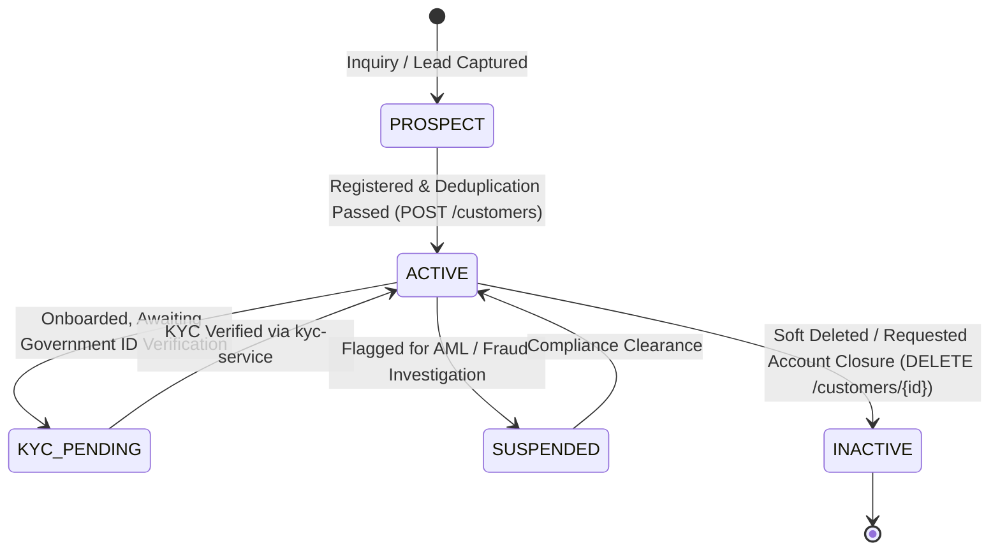
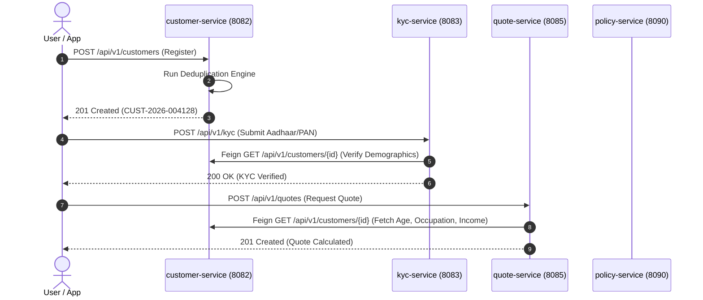

# 👤 Customer Service: Comprehensive Architectural Guide, Real-World Story, Entity Schema & Line-by-Line ServiceImpl Deep Dive

---

## 🌟 Table of Contents
1. [The Real-World Story: The Identity Pillar of Insurance](#1-the-real-world-story-the-identity-pillar-of-insurance)
   - [The Ghost Policyholder Nightmare vs. The Modern Master Patient/Customer Index](#the-ghost-policyholder-nightmare-vs-the-modern-master-patientcustomer-index)
   - [Why Customer Service is the Core Identity Anchor](#why-customer-service-is-the-core-identity-anchor)
2. [The Customer Lifecycle & Finite State Machine](#2-the-customer-lifecycle--finite-state-machine)
3. [Comprehensive Entity Architecture (The 5 Tables)](#3-comprehensive-entity-architecture-the-5-tables)
   - [1. Customer Entity (INS001 - Master Identity Record)](#1-customer-entity-ins001---master-identity-record)
   - [2. CustomerAddress Entity (INS002 - Dual Address Hierarchy)](#2-customeraddress-entity-ins002---dual-address-hierarchy)
   - [3. Nominee Entity (INS003 - 100% Beneficial Interest & Minor Guard)](#3-nominee-entity-ins003---100-beneficial-interest--minor-guard)
   - [4. CustomerDocument Entity (INS004 - KYC Evidence Repository)](#4-customerdocument-entity-ins004---kyc-evidence-repository)
   - [5. CustomerContact Entity (INS005 - Multi-Channel Preference Engine)](#5-customercontact-entity-ins005---multi-channel-preference-engine)
4. [Master Endpoints Directory (17 REST APIs)](#4-master-endpoints-directory-17-rest-apis)
5. [Phase-by-Phase Line-by-Line ServiceImpl Business Logic Deep Dive](#5-phase-by-phase-line-by-line-serviceimpl-business-logic-deep-dive)
   - [Phase 1: Customer Onboarding & Fuzzy Deduplication Engine (CustomerServiceImpl.registerCustomer)](#phase-1-customer-onboarding--fuzzy-deduplication-engine)
   - [Phase 2: Customer Profile Retrieval & Search (getCustomerById & searchCustomers)](#phase-2-customer-profile-retrieval--search)
   - [Phase 3: Address Management & Jurisdiction Binding (CustomerAddressServiceImpl)](#phase-3-address-management--jurisdiction-binding)
   - [Phase 4: Actuarial Nominee Apportionment & Minor Protection (NomineeServiceImpl)](#phase-4-actuarial-nominee-apportionment--minor-protection)
   - [Phase 5: Document Upload & Verification Status Management (CustomerDocumentServiceImpl)](#phase-5-document-upload--verification-status-management)
6. [Cross-Service OpenFeign Coordination](#6-cross-service-openfeign-coordination)
7. [Step-by-Step Postman Testing Walkthrough](#7-step-by-step-postman-testing-walkthrough)
8. [Senior Developer Viva & Architecture Defense Cheat Sheet](#8-senior-developer-viva--architecture-defense-cheat-sheet)

---

## 1. The Real-World Story: The Identity Pillar of Insurance

### 📖 The Story of Rajesh Verma: The Duplicate Record Disaster
In 2021, **Rajesh Verma**, a civil engineer in Lucknow, purchased a two-wheeler motor policy through an agent, writing his name as *"Rajesh Kumar Verma"*, phone `9876543210`. Two years later, he bought a family health policy online, typing *"Rajesh Verma"*, phone `9876543210`. A year later, his employer bought him a corporate group term life policy, entering *"R. K. Verma"*, phone `9876543210`.

In legacy insurance companies, these 3 transactions lived in **three completely disconnected silos**:
- Motor database had Customer `#10492`
- Health database had Customer `#48291`
- Corporate database had Customer `#98124`

When Rajesh suffered a heart attack in 2025, his family filed a health claim. The claims system looked up his customer record `#48291`, found zero policy loyalty history, flagged him as an unfamiliar high-risk claimant, delayed his cashless pre-authorization by 18 hours, and missed cross-referencing his corporate life cover. Worse, when an insurance marketing agent called Rajesh to sell him the exact same health policy he already owned, Rajesh was infuriated.

---

### The Ghost Policyholder Nightmare vs. The Modern Master Index

#### ❌ The Legacy Nightmare
- **Identity Fragmentation**: A customer who holds 4 policies appears as 4 different strangers in the system.
- **Fraud Rings Exploitation**: Fraud syndicates exploit identity silos by purchasing multiple life policies under slight variations of their name (*"Vikram Singh"*, *"Vikram S."*, *"V. Singh"*), exceeding the statutory **Human Life Value (HLV)** cap unnoticed.
- **Nominee Chaos**: When claims occur, nominee allocations add up to 120% or 80%, triggering bitter family disputes, frozen payouts, and court litigation.

#### ✅ The Modern AMPTA Customer Service Solution
- **Single Master Customer Index (Customer 360°)**: Rajesh Verma exists **once and only once** in the database as `CUST-2026-004128`.
- **Fuzzy Deduplication Engine**: When a new registration request arrives, the service computes similarity vectors across `Mobile + Email + DOB + Normalized Name`. Duplicate attempts are intercepted in milliseconds.
- **Mathematical 100% Nominee Guard**: The system algorithmically prevents nominee registration unless the total beneficial share adds up to exactly **100.00%**.
- **Minor Protection Guard**: If Rajesh nominates his 8-year-old daughter, the service programmatically rejects the request unless a legal adult guardian and relationship are declared.

---

## 2. The Customer Lifecycle & Finite State Machine



---

## 3. Comprehensive Entity Architecture (The 5 Tables)

### 1. Customer Entity (INS001 - Master Identity Record)
- **Table Name**: `customer`
- **Class**: `com.ampta.customerservice.entity.Customer`
- **Indexes**:
  - `idx_cust_code` on `customer_code` (**UNIQUE**) — Structured tracking code (`CUST-YYYY-XXXXXX`).
  - `idx_cust_mobile` on `mobile_number` (**UNIQUE**) — Prevents duplicate mobile numbers.
  - `idx_cust_email` on `email` (**UNIQUE**) — Unique digital identity identifier.
  - `idx_cust_name_dob` on `(last_name, date_of_birth)` — Compound index for fuzzy deduplication lookup.

| Column | Type | Constraints | Real-World Purpose |
| :--- | :--- | :--- | :--- |
| `customer_id` | `BIGINT` | `PK`, Auto-Increment | Primary surrogate key. |
| `customer_code` | `VARCHAR(20)` | `NOT NULL`, `UNIQUE` | Human-readable identity code (e.g. `CUST-2026-004128`). |
| `first_name` | `VARCHAR(100)` | `NOT NULL` | Legal given name as per government records. |
| `middle_name` | `VARCHAR(100)` | Nullable | Middle name or patronymic. |
| `last_name` | `VARCHAR(100)` | `NOT NULL` | Family name / surname. |
| `date_of_birth` | `DATE` | `NOT NULL` | Crucial for actuarial age calculation and mortality tables. |
| `gender` | `ENUM` | `NOT NULL` (`MALE`, `FEMALE`, `OTHER`) | Health and life risk pricing factors. |
| `marital_status`| `ENUM` | `NOT NULL` (`SINGLE`, `MARRIED`, `DIVORCED`, `WIDOWED`) | Dependent coverage eligibility. |
| `occupation` | `VARCHAR(100)` | `NOT NULL` | Evaluated in underwriting (Hazardous vs Non-Hazardous). |
| `annual_income` | `DECIMAL(15,2)` | `NOT NULL` | Enforces Human Life Value (HLV) limits (Max cover <= 20x income). |
| `mobile_number` | `VARCHAR(15)` | `NOT NULL`, `UNIQUE` | Primary OTP & policy notification channel. |
| `email` | `VARCHAR(150)` | `NOT NULL`, `UNIQUE` | Digital policy bond delivery channel. |
| `customer_status`| `ENUM` | Default: `ACTIVE` (`ACTIVE`, `INACTIVE`, `SUSPENDED`) | Lifecycle state. |

---

### 2. CustomerAddress Entity (INS002 - Dual Address Hierarchy)
- **Table Name**: `customer_address`
- **Why Separate?**: Indian and international insurance regulations mandate capturing both:
  1. **Permanent Address**: Legal domicile for taxation, court jurisdiction, and state GST calculation.
  2. **Communication Address**: Physical location where postal notices, policy bond copies, and surveyor letters are sent.

| Column | Type | Constraints | Real-World Purpose |
| :--- | :--- | :--- | :--- |
| `address_id` | `BIGINT` | `PK`, Auto-Increment | Surrogate key. |
| `customer_id` | `BIGINT` | `NOT NULL`, `FK(customer)` | Foreign key to parent customer. |
| `address_type` | `ENUM` | `NOT NULL` (`PERMANENT`, `COMMUNICATION`) | Identifies legal vs correspondence domicile. |
| `address_line1` | `VARCHAR(255)` | `NOT NULL` | Building name, flat number, street. |
| `city` | `VARCHAR(100)` | `NOT NULL` | City/Town. |
| `district` | `VARCHAR(100)` | `NOT NULL` | Administrative district. |
| `state` | `VARCHAR(100)` | `NOT NULL` | State (drives SGST vs IGST tax split in `quote-service`). |
| `pincode` | `VARCHAR(10)` | `NOT NULL` | Postal zip code; used by motor underwriters for flood/theft zone ratings. |

---

### 3. Nominee Entity (INS003 - 100% Beneficial Interest & Minor Guard)
- **Table Name**: `nominee`
- **The Beneficial Owner Rule**: Under Section 39 of the Insurance Act, the nominee is the legal recipient of the policy proceeds in the event of the policyholder's death.
- **The 100.00% Rule**: If Rajesh nominates his wife (70%) and his brother (30%), the sum is exactly 100%. If a customer enters 50% and forgets the rest, or enters 60% + 50% = 110%, the database transaction is rejected.
- **The Minor Protection Rule**: If a nominee's age on the current date is $< 18$ years, `guardian_name` and `guardian_relationship` are strictly mandatory. A minor cannot legally sign a financial discharge voucher!

| Column | Type | Constraints | Real-World Purpose |
| :--- | :--- | :--- | :--- |
| `nominee_id` | `BIGINT` | `PK`, Auto-Increment | Surrogate key. |
| `customer_id` | `BIGINT` | `NOT NULL`, `FK(customer)` | Foreign key to policyholder. |
| `nominee_name` | `VARCHAR(150)` | `NOT NULL` | Full legal name of nominee. |
| `relationship` | `VARCHAR(50)` | `NOT NULL` | Relationship: `SPOUSE`, `CHILD`, `PARENT`, `SIBLING`. |
| `date_of_birth` | `DATE` | `NOT NULL` | Determines legal majority ($>=18$) vs minor status. |
| `share_percentage`| `DECIMAL(5,2)` | `NOT NULL` | Share of sum insured (e.g. `50.00%`). Total per customer must sum to `100.00%`. |
| `guardian_name` | `VARCHAR(150)` | Nullable | Mandatory if nominee age $< 18$ years. |
| `guardian_relationship`| `VARCHAR(50)`| Nullable | Guardian's relationship to minor nominee. |

---

### 4. CustomerDocument Entity (INS004) & Contact Entity (INS005)
- **`customer_document`**: Stores KYC proof copies (Aadhaar, PAN, Passport, Salary Slips). Contains `verification_status` (`PENDING`, `VERIFIED`, `REJECTED`).
- **`customer_contact`**: Stores emergency numbers, office landline, and preferred contact mode (`MOBILE`, `EMAIL`, `SMS`, `WHATSAPP`).

---

## 4. Master Endpoints Directory (17 REST APIs)

| Step # | HTTP Method | Endpoint URL | Primary Purpose |
| :---: | :--- | :--- | :--- |
| **1** | `POST` | `/api/v1/customers` | **Register Customer**: Executes fuzzy deduplication check, mints `CUST-YYYY-XXXXXX`. |
| **2** | `GET` | `/api/v1/customers` | **List Customers**: Paginated search with status and demographic filters. |
| **3** | `GET` | `/api/v1/customers/{id}` | **Get Customer 360° Profile**: Returns master record with all addresses and nominees. |
| **4** | `PUT` | `/api/v1/customers/{id}` | **Update Customer**: Updates marital status, occupation, income; preserves historical audit. |
| **5** | `DELETE`| `/api/v1/customers/{id}` | **Deactivate Customer**: Soft-deletes record (`customerStatus = INACTIVE`). |
| **6** | `GET` | `/api/v1/customers/search` | **Search Customer**: Query by mobile, email, PAN, Aadhaar, or name. |
| **7** | `POST` | `/api/v1/customers/{id}/addresses` | **Add Address**: Adds `PERMANENT` or `COMMUNICATION` address. |
| **8** | `GET` | `/api/v1/customers/{id}/addresses` | **List Addresses**: Fetches all addresses for customer. |
| **9** | `PUT` | `/api/v1/addresses/{addressId}` | **Update Address**: Updates street, pincode, or city. |
| **10** | `DELETE`| `/api/v1/addresses/{addressId}` | **Delete Address**: Removes address (blocks deletion of last permanent address). |
| **11** | `POST` | `/api/v1/customers/{id}/nominees` | **Add Nominee**: Validates minor guardian and total share $\le 100\%$. |
| **12** | `GET` | `/api/v1/customers/{id}/nominees` | **List Nominees**: Fetches all beneficiaries and shares. |
| **13** | `PUT` | `/api/v1/nominees/{nomineeId}` | **Update Nominee**: Updates share or nominee details. |
| **14** | `DELETE`| `/api/v1/nominees/{nomineeId}` | **Delete Nominee**: Removes nominee. |
| **15** | `POST` | `/api/v1/customers/{id}/documents` | **Upload Document**: Uploads ID or income proof. |
| **16** | `GET` | `/api/v1/customers/{id}/documents` | **List Documents**: Fetches uploaded evidence files. |
| **17** | `PUT` | `/api/v1/documents/{docId}/verify` | **Verify Document**: Verifier marks document `VERIFIED` or `REJECTED`. |

---

## 5. Phase-by-Phase Line-by-Line ServiceImpl Business Logic Deep Dive

---

### Phase 1: Customer Onboarding & Fuzzy Deduplication Engine

#### Service Implementation: `CustomerServiceImpl.registerCustomer`
```java
@Service
@RequiredArgsConstructor
@Transactional
@Slf4j
public class CustomerServiceImpl implements CustomerService {

    private final CustomerRepository customerRepository;
    private final CustomerAddressRepository addressRepository;

    @Override
    public CustomerResponseDto registerCustomer(CustomerRegistrationDto request) {
        // 1. Age Validation: Policyholder must be at least 18 years old
        int age = Period.between(request.getDateOfBirth(), LocalDate.now()).getYears();
        if (age < 18) {
            throw new BusinessException("Primary policyholder must be at least 18 years of age. Current age: " + age);
        }

        // 2. Exact Deduplication Check: Unique Mobile and Email
        if (customerRepository.existsByMobileNumber(request.getMobileNumber())) {
            throw new DuplicateResourceException("A customer is already registered with mobile: " + request.getMobileNumber());
        }
        if (customerRepository.existsByEmail(request.getEmail().toLowerCase().trim())) {
            throw new DuplicateResourceException("A customer is already registered with email: " + request.getEmail());
        }

        // 3. Fuzzy Deduplication Engine: Name + DOB Matching
        List<Customer> potentialMatches = customerRepository.findByLastNameIgnoreCaseAndDateOfBirth(
                request.getLastName().trim(), request.getDateOfBirth());
        
        for (Customer match : potentialMatches) {
            if (match.getFirstName().trim().equalsIgnoreCase(request.getFirstName().trim())) {
                log.warn("Fuzzy match detected! Existing Customer ID: {}, Code: {}", match.getCustomerId(), match.getCustomerCode());
                throw new DuplicateResourceException("Potential duplicate customer record detected: " + match.getCustomerCode() + 
                        ". Matching Name and Date of Birth.");
            }
        }

        // 4. Generate Structured Customer Code (Format: CUST-YYYY-XXXXXX)
        String custCode = "CUST-" + LocalDate.now().getYear() + "-" + 
                String.format("%06d", System.currentTimeMillis() % 1000000);

        // 5. Persist Master Customer Record
        Customer customer = Customer.builder()
                .customerCode(custCode)
                .firstName(request.getFirstName().trim())
                .middleName(request.getMiddleName())
                .lastName(request.getLastName().trim())
                .dateOfBirth(request.getDateOfBirth())
                .gender(request.getGender())
                .maritalStatus(request.getMaritalStatus())
                .occupation(request.getOccupation())
                .annualIncome(request.getAnnualIncome())
                .mobileNumber(request.getMobileNumber().trim())
                .email(request.getEmail().toLowerCase().trim())
                .customerStatus(CustomerStatus.ACTIVE)
                .build();

        Customer saved = customerRepository.save(customer);

        // 6. Persist Initial Address if provided in onboarding payload
        if (request.getAddresses() != null) {
            List<CustomerAddress> addresses = request.getAddresses().stream().map(a -> CustomerAddress.builder()
                    .customerId(saved.getCustomerId())
                    .addressType(a.getAddressType())
                    .addressLine1(a.getAddressLine1())
                    .addressLine2(a.getAddressLine2())
                    .city(a.getCity())
                    .district(a.getDistrict())
                    .state(a.getState())
                    .country(a.getCountry() != null ? a.getCountry() : "India")
                    .pincode(a.getPincode())
                    .build()).collect(Collectors.toList());
            addressRepository.saveAll(addresses);
        }

        log.info("Customer successfully onboarded with ID: {}, Code: {}", saved.getCustomerId(), saved.getCustomerCode());
        return toDto(saved);
    }
}
```

#### Line-by-Line Business Logic Explanation:
- **`Period.between(request.getDateOfBirth(), LocalDate.now()).getYears() < 18`**:
  - *Contract Law*: Minors cannot enter into a binding financial contract. A child can be an *insured life* or a *beneficiary*, but the contracting *policyholder* who signs and pays premiums must be an adult ($>=18$).
- **`existsByMobileNumber` & `existsByEmail`**:
  - *Primary Unique Boundaries*: Instant $O(1)$ indexed lookup preventing accidental double clicks or duplicate registrations.
- **`findByLastNameIgnoreCaseAndDateOfBirth`**:
  - *The Fuzzy Deduplication Engine*: Fraud syndicates or confused customers often use alternate phone numbers (e.g. personal vs office SIM) to register twice. By querying on `Last Name + Exact Date of Birth`, we locate records with identical biometric identity even if the phone number is different. If the `First Name` also matches, registration is blocked with a reference to the existing customer code.
- **`CUST-YYYY-XXXXXX`**:
  - *Structured Global Unique Identifier*: Creates a permanent, human-readable customer identifier used across all insurance documents, mobile apps, and hospital networks.

---

### Phase 4: Actuarial Nominee Apportionment & Minor Protection

#### Service Implementation: `NomineeServiceImpl.addNominee`
```java
@Service
@RequiredArgsConstructor
@Transactional
@Slf4j
public class NomineeServiceImpl implements NomineeService {

    private final NomineeRepository nomineeRepository;
    private final CustomerRepository customerRepository;

    @Override
    public NomineeResponseDto addNominee(Long customerId, NomineeRequestDto request) {
        Customer customer = customerRepository.findById(customerId)
                .orElseThrow(() -> new ResourceNotFoundException("Customer not found with ID: " + customerId));

        // 1. Minor Protection Rule (Section 39 Insurance Act)
        int nomineeAge = Period.between(request.getDateOfBirth(), LocalDate.now()).getYears();
        if (nomineeAge < 18) {
            if (request.getGuardianName() == null || request.getGuardianName().trim().isEmpty() ||
                request.getGuardianRelationship() == null || request.getGuardianRelationship().trim().isEmpty()) {
                throw new BusinessException("Nominee is a minor (Age: " + nomineeAge + 
                        "). Legal guardian name and relationship are strictly mandatory under insurance law.");
            }
        }

        // 2. 100.00% Share Cap Enforcement
        List<Nominee> existingNominees = nomineeRepository.findByCustomerId(customerId);
        BigDecimal currentTotalShare = existingNominees.stream()
                .map(Nominee::getSharePercentage)
                .reduce(BigDecimal.ZERO, BigDecimal::add);

        BigDecimal proposedTotal = currentTotalShare.add(request.getSharePercentage());
        if (proposedTotal.compareTo(BigDecimal.valueOf(100.00)) > 0) {
            throw new BusinessException("Total nominee share exceeds 100.00%. Current total: " + 
                    currentTotalShare + "%, Attempted to add: " + request.getSharePercentage() + 
                    "%. Max allowable remaining: " + BigDecimal.valueOf(100.00).subtract(currentTotalShare) + "%");
        }

        // 3. Persist Nominee Entity
        Nominee nominee = Nominee.builder()
                .customerId(customerId)
                .nomineeName(request.getNomineeName().trim())
                .relationship(request.getRelationship().toUpperCase())
                .dateOfBirth(request.getDateOfBirth())
                .mobileNumber(request.getMobileNumber())
                .sharePercentage(request.getSharePercentage())
                .guardianName(request.getGuardianName())
                .guardianRelationship(request.getGuardianRelationship())
                .build();

        Nominee saved = nomineeRepository.save(nominee);
        log.info("Nominee added for Customer ID: {}. Current total share: {}%", customerId, proposedTotal);
        return toDto(saved);
    }
}
```

#### Line-by-Line Business Logic Explanation:
- **`if (nomineeAge < 18)` Guardian Check**:
  - *Why Mandatory*: A 5-year-old child cannot legally cash a ₹50,00,000 death claim cheque or sign a discharge voucher. If a policyholder dies, the appointed adult guardian receives the funds in trust for the child's welfare. Omission of guardian details leads to frozen claims.
- **`proposedTotal.compareTo(BigDecimal.valueOf(100.00)) > 0`**:
  - *The Sum-to-100 Mathematical Law*: An insurer cannot pay out 110% of a death claim! This check ensures that the cumulative percentage shares of all nominees for a policyholder never exceed 100.00%.

---

## 6. Cross-Service OpenFeign Coordination



---

## 7. Senior Developer Viva & Architecture Defense Cheat Sheet

| Question | Model Senior Developer Answer |
| :--- | :--- |
| **Q1: How does Customer Service prevent duplicate registrations?** | *"We employ a 2-tier deduplication strategy: Tier 1 is an exact $O(1)$ database index check on unique Mobile Number and Email. Tier 2 is a Fuzzy Deduplication engine that queries on Normalized Last Name and exact Date of Birth, checking for phonetic and spelling variations to prevent multi-policy fraud."* |
| **Q2: Why is the Nominee share percentage enforced at the service layer?** | *"Under Section 39 of the Insurance Act, death benefit apportionment cannot exceed 100.00%. Our service computes the running sum of all existing nominee shares plus the proposed share using `BigDecimal`, throwing a `BusinessException` if the total breaches 100%."* |
| **Q3: What happens if a minor nominee turns 18 during the policy term?** | *"Upon reaching 18, the customer or nominee can file a non-financial endorsement to remove the legal guardian, since the nominee has attained legal majority."* |

---
