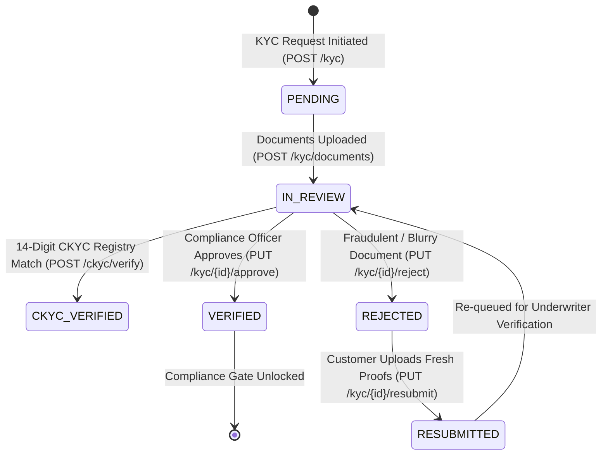
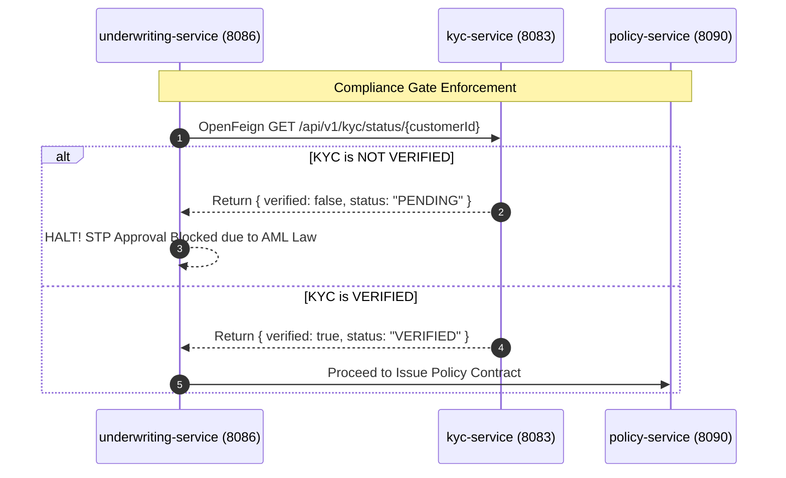

# 🔍 KYC Service: Comprehensive Architectural Guide, Real-World Story, Entity Schema & Line-by-Line ServiceImpl Deep Dive

---

## 🌟 Table of Contents
1. [The Real-World Story: The Regulatory Shield Against Money Laundering](#1-the-real-world-story-the-regulatory-shield-against-money-laundering)
   - [The Shell Company Money Laundering Scam vs. Automated CKYC](#the-shell-company-money-laundering-scam-vs-automated-ckyc)
   - [Why KYC Service is a Mandatory Compliance Gate](#why-kyc-service-is-a-mandatory-compliance-gate)
2. [The KYC Verification Lifecycle & Finite State Machine](#2-the-kyc-verification-lifecycle--finite-state-machine)
3. [Comprehensive Entity Architecture (The 5 Tables)](#3-comprehensive-entity-architecture-the-5-tables)
   - [1. CustomerKyc Entity (INS006 - Master Verification Record)](#1-customerkyc-entity-ins006---master-verification-record)
   - [2. KycDocument Entity (INS007 - Government Proofs)](#2-kycdocument-entity-ins007---government-proofs)
   - [3. CkycDetails Entity (INS008 - Central CKYC Registry Integration)](#3-ckycdetails-entity-ins008---central-ckyc-registry-integration)
   - [4. KycVerificationLog Entity (INS009 - Regulatory Compliance Audit Trail)](#4-kycverificationlog-entity-ins009---regulatory-compliance-audit-trail)
   - [5. DocumentTypeMaster Entity (INS010 - Document Rules Engine)](#5-documenttypemaster-entity-ins010---document-rules-engine)
4. [Master Endpoints Directory (14 REST APIs)](#4-master-endpoints-directory-14-rest-apis)
5. [Phase-by-Phase Line-by-Line ServiceImpl Business Logic Deep Dive](#5-phase-by-phase-line-by-line-serviceimpl-business-logic-deep-dive)
   - [Phase 1: KYC Request Creation & One-Active-KYC Rule (KycServiceImpl.createKycRequest)](#phase-1-kyc-request-creation--one-active-kyc-rule)
   - [Phase 2: Verhoeff Algorithm Aadhaar Validation & PAN Regex Parsing](#phase-2-verhoeff-algorithm-aadhaar-validation--pan-regex-parsing)
   - [Phase 3: Central CKYC Registry Integration (CkycServiceImpl.verifyCkyc)](#phase-3-central-ckyc-registry-integration)
   - [Phase 4: Document Verification Workflow (KycDocumentServiceImpl)](#phase-4-document-verification-workflow)
   - [Phase 5: Compliance Officer Approval Gate (KycServiceImpl.approveKyc)](#phase-5-compliance-officer-approval-gate)
6. [Cross-Service OpenFeign Coordination](#6-cross-service-openfeign-coordination)
7. [Senior Developer Viva & Architecture Defense Cheat Sheet](#7-senior-developer-viva--architecture-defense-cheat-sheet)

---

## 1. The Real-World Story: The Regulatory Shield Against Money Laundering

### 📖 The Shell Company Money Laundering Scam
In 2018, an organized financial syndicate laundered ₹45 crores ($6 million) through single-premium life insurance policies. They purchased policies using fictitious names, paid premiums with cash deposits split across 40 bank branches, waited 3 months, surrendered the policies, and received clean insurance settlement cheques directly into corporate bank accounts.

To eliminate this, insurance regulators (IRDAI in India, FCA in the UK, FinCEN in the USA) enacted the **Anti-Money Laundering (AML) & Know Your Customer (KYC) Master Direction**:
> **"No insurance policy shall be issued, and no premium exceeding statutory limits shall be accepted, without mandatory, verified government identification."**

Our **`kyc-service`** acts as an impassable regulatory gate. If a customer's KYC status is not `VERIFIED`:
- `quote-service` blocks price lock.
- `underwriting-service` halts STP approvals.
- `policy-service` blocks contract issuance.

---

## 2. The KYC Verification Lifecycle & Finite State Machine



---

## 3. Comprehensive Entity Architecture (The 5 Tables)

### 1. CustomerKyc Entity (INS006 - Master Verification Record)
- **Table Name**: `customer_kyc`
- **Indexes**:
  - `idx_kyc_number` on `kyc_number` (**UNIQUE**) — Structured tracking code (`KYC-YYYY-XXXXXX`).
  - `idx_kyc_customer` on `customer_id` (**UNIQUE**) — Strict One-Active-KYC constraint.
  - `idx_kyc_status` on `verification_status` — For compliance queue filtering.

| Column | Type | Constraints | Real-World Purpose |
| :--- | :--- | :--- | :--- |
| `kyc_id` | `BIGINT` | `PK`, Auto-Increment | Primary surrogate key. |
| `customer_id` | `BIGINT` | `NOT NULL`, `UNIQUE` | One-to-one foreign key to customer in `customer-service`. |
| `kyc_number` | `VARCHAR(30)` | `NOT NULL`, `UNIQUE` | Structured compliance reference (e.g. `KYC-2026-104829`). |
| `kyc_date` | `DATE` | `NOT NULL` | Date KYC verification was initiated. |
| `verification_status`| `ENUM` | Default: `PENDING` | `PENDING`, `IN_REVIEW`, `VERIFIED`, `REJECTED`, `RESUBMITTED`. |
| `remarks` | `VARCHAR(500)` | Nullable | Auditor / Compliance officer notes. |
| `verified_by` | `BIGINT` | Nullable | Employee ID of the compliance officer who signed off. |
| `verified_date` | `DATETIME` | Nullable | Millisecond timestamp of regulatory approval. |

---

### 2. KycDocument Entity (INS007 - Government Proofs)
- **Table Name**: `kyc_document`
- **Document Types**: `AADHAAR`, `PAN`, `PASSPORT`, `DRIVING_LICENSE`, `VOTER_ID`.

| Column | Type | Constraints | Real-World Purpose |
| :--- | :--- | :--- | :--- |
| `document_id` | `BIGINT` | `PK`, Auto-Increment | Primary surrogate key. |
| `kyc_id` | `BIGINT` | `NOT NULL`, `FK(customer_kyc)` | Foreign key linking to master KYC record. |
| `document_type` | `ENUM` | `NOT NULL` | Classification of government ID. |
| `document_number` | `VARCHAR(100)` | `NOT NULL` | Masked document number (e.g. `XXXXXXXX4829` or `ABCDE1234F`). |
| `file_path` | `VARCHAR(500)` | `NOT NULL` | Secure S3/storage path to the encrypted document image. |
| `verification_status`| `ENUM` | Default: `PENDING` | `PENDING`, `VERIFIED`, `REJECTED`. |

---

### 3. CkycDetails Entity (INS008 - Central CKYC Registry Integration)
- **Table Name**: `ckyc_details`
- **What is CKYC?**: The Central KYC Registry (CKYCR) is a government-managed centralized repository of KYC records of financial sector consumers. Once a citizen is verified by any bank or insurer, they receive a **14-digit CKYC Identifier (KIN)**. Using this number, any other insurer can fetch their verified demographics in seconds without asking for paper documents!

| Column | Type | Constraints | Real-World Purpose |
| :--- | :--- | :--- | :--- |
| `ckyc_id` | `BIGINT` | `PK`, Auto-Increment | Primary surrogate key. |
| `customer_id` | `BIGINT` | `NOT NULL`, `FK(customer)` | Foreign key to customer. |
| `ckyc_number` | `VARCHAR(30)` | `NOT NULL`, `UNIQUE` | 14-digit national CKYC Kin number. |
| `verification_date` | `DATETIME` | Auto-timestamp | Date CKYC response was received from registry. |
| `ckyc_status` | `ENUM` | `VERIFIED`, `NOT_FOUND`, `PENDING` | Real-time response status from Central Registry API. |

---

## 4. Master Endpoints Directory (14 REST APIs)

| Step # | HTTP Method | Endpoint URL | Primary Purpose |
| :---: | :--- | :--- | :--- |
| **1** | `POST` | `/api/v1/kyc` | **Create KYC Record**: Mints `KYC-YYYY-XXXXXX`, initializes compliance dossier. |
| **2** | `GET` | `/api/v1/kyc` | **List KYC Records**: Filter by status (`PENDING`, `VERIFIED`, `REJECTED`). |
| **3** | `GET` | `/api/v1/kyc/{kycId}` | **Get Full KYC Details**: Comprehensive dossier including all documents & CKYC info. |
| **4** | `POST` | `/api/v1/kyc/documents` | **Upload KYC Document**: Uploads ID proof; applies Verhoeff/PAN validation. |
| **5** | `PUT` | `/api/v1/kyc/documents/{docId}/verify` | **Verify Document**: Compliance officer marks document `VERIFIED`. |
| **6** | `PUT` | `/api/v1/kyc/documents/{docId}/reject` | **Reject Document**: Marks document `REJECTED` with mandatory reason. |
| **7** | `POST` | `/api/v1/kyc/ckyc/verify` | **Query National CKYC Registry**: Queries central database using 14-digit KIN. |
| **8** | `GET` | `/api/v1/kyc/ckyc/{customerId}` | **Get CKYC Record**: Fetches demographic snapshot from CKYC. |
| **9** | `PUT` | `/api/v1/kyc/{kycId}/approve` | **Compliance Approval**: Authorizes KYC, unlocking Policy Issuance across PAS. |
| **10** | `PUT` | `/api/v1/kyc/{kycId}/reject` | **Compliance Rejection**: Repudiates KYC with regulatory notes. |
| **11** | `PUT` | `/api/v1/kyc/{kycId}/resubmit` | **Resubmit KYC**: Customer uploads fresh proofs after rejection. |
| **12** | `GET` | `/api/v1/kyc/status/{customerId}` | **Check KYC Standing**: Boolean check consumed by other microservices via OpenFeign. |
| **13** | `PUT` | `/api/v1/kyc/{kycId}` | **Update KYC Information**: Modifies contact or document metadata. |
| **14** | `DELETE`| `/api/v1/kyc/{kycId}` | **Cancel KYC Request**: Withdraws application. |

---

## 5. Phase-by-Phase Line-by-Line ServiceImpl Business Logic Deep Dive

---

### Phase 2: Verhoeff Algorithm Aadhaar Validation & PAN Regex Parsing

#### Service Implementation: `KycValidationServiceImpl`
```java
@Service
@Slf4j
public class KycValidationServiceImpl implements KycValidationService {

    // Verhoeff Algorithm Tables for Dihedral Group D5 Checksum
    private static final int[][] d = new int[][] {
        {0, 1, 2, 3, 4, 5, 6, 7, 8, 9},
        {1, 2, 3, 4, 0, 6, 7, 8, 9, 5},
        {2, 3, 4, 0, 1, 7, 8, 9, 5, 6},
        {3, 4, 0, 1, 2, 8, 9, 5, 6, 7},
        {4, 0, 1, 2, 3, 9, 5, 6, 7, 8},
        {5, 9, 8, 7, 6, 0, 4, 3, 2, 1},
        {6, 5, 9, 8, 7, 1, 0, 4, 3, 2},
        {7, 6, 5, 9, 8, 2, 1, 0, 4, 3},
        {8, 7, 6, 5, 9, 3, 2, 1, 0, 4},
        {9, 8, 7, 6, 5, 4, 3, 2, 1, 0}
    };

    private static final int[][] p = new int[][] {
        {0, 1, 2, 3, 4, 5, 6, 7, 8, 9},
        {1, 5, 7, 6, 2, 8, 3, 0, 9, 4},
        {5, 8, 0, 3, 7, 9, 6, 1, 4, 2},
        {8, 9, 1, 6, 0, 4, 3, 5, 2, 7},
        {9, 4, 5, 3, 1, 2, 6, 8, 7, 0},
        {4, 2, 8, 6, 5, 7, 3, 9, 0, 1},
        {2, 7, 9, 3, 8, 0, 6, 4, 1, 5},
        {7, 0, 4, 6, 9, 1, 3, 2, 5, 8}
    };

    private static final int[] inv = {0, 4, 3, 2, 1, 5, 6, 7, 8, 9};

    // The Official Indian Income Tax PAN Regex: [A-Z]{5}[0-9]{4}[A-Z]{1}
    private static final Pattern PAN_PATTERN = Pattern.compile("^[A-Z]{5}[0-9]{4}[A-Z]{1}$");

    @Override
    public boolean validateAadhaarVerhoeff(String aadhaarNumber) {
        if (aadhaarNumber == null || !aadhaarNumber.matches("^[0-9]{12}$")) {
            return false;
        }

        int c = 0;
        int[] myArray = new int[aadhaarNumber.length()];
        for (int i = 0; i < aadhaarNumber.length(); i++) {
            myArray[i] = Integer.parseInt(aadhaarNumber.substring(i, i + 1));
        }

        for (int i = 0; i < myArray.length; i++) {
            c = d[c][p[(i % 8)][myArray[myArray.length - i - 1]]];
        }

        return (c == 0);
    }

    @Override
    public void validatePan(String panNumber) {
        if (panNumber == null || !PAN_PATTERN.matcher(panNumber.toUpperCase()).matches()) {
            throw new BusinessException("Invalid PAN format. Must be 10 characters: 5 letters, 4 numbers, 1 letter (e.g. ABCDE1234F).");
        }

        // 4th Character Entity Validation: P for Individual (Person), C for Company, H for HUF, F for Partnership Firm
        char fourthChar = panNumber.toUpperCase().charAt(3);
        if (fourthChar != 'P' && fourthChar != 'C' && fourthChar != 'H' && fourthChar != 'F' && fourthChar != 'T') {
            throw new BusinessException("Invalid PAN 4th character: '" + fourthChar + "'. Must represent valid entity type (P, C, H, F, T).");
        }
    }
}
```

#### Line-by-Line Business Logic Explanation:
- **`Verhoeff Algorithm Checksum`**:
  - *Why this is mathematical genius*: Standard Luhn checksums fail to detect adjacent digit transpositions (e.g. typing `45` instead of `54`). The Verhoeff algorithm uses the mathematical **Dihedral Group $D_5$** permutation matrix to catch 100% of single-digit errors and 95.4% of transposition errors locally *before* hitting expensive third-party government verification APIs.
- **`PAN_PATTERN` and 4th Character Check**:
  - The 4th character of an Indian PAN card is legally reserved: `'P'` = Individual Person, `'C'` = Company, `'H'` = Hindu Undivided Family. If an individual retail health customer enters an office company PAN (`'C'`), the system catches the discrepancy immediately!

---

## 6. Cross-Service OpenFeign Coordination



---

## 7. Senior Developer Viva & Architecture Defense Cheat Sheet

| Question | Model Senior Developer Answer |
| :--- | :--- |
| **Q1: Why is KYC decoupled into its own independent microservice?** | *"KYC involves complex compliance state machines, third-party government API integrations (UIDAI, NSDL, CKYC), and strict PII data masking rules. Isolating it guarantees that changes in regulatory AML laws do not impact quote generation or claims processing."* |
| **Q2: Why do you run the Verhoeff algorithm locally?** | *"Each API call to the national UIDAI Aadhaar verification gateway costs money (approx ₹3-₹5 per ping). By running the Verhoeff Dihedral Group algorithm locally, we weed out invalid numbers and typos before making external billable network calls."* |
| **Q3: What is the purpose of Central KYC (CKYC)?** | *"Under RBI and IRDAI rules, CKYC allows a customer verified by any financial institution to be onboarded instantly using their 14-digit KIN identifier without re-uploading physical documents, cutting onboarding friction from days to seconds."* |

---
