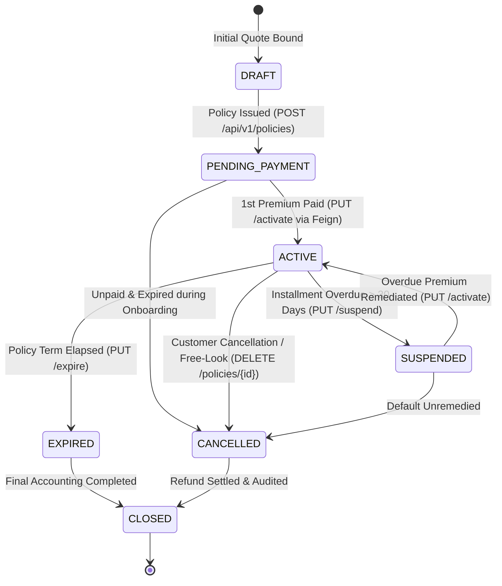
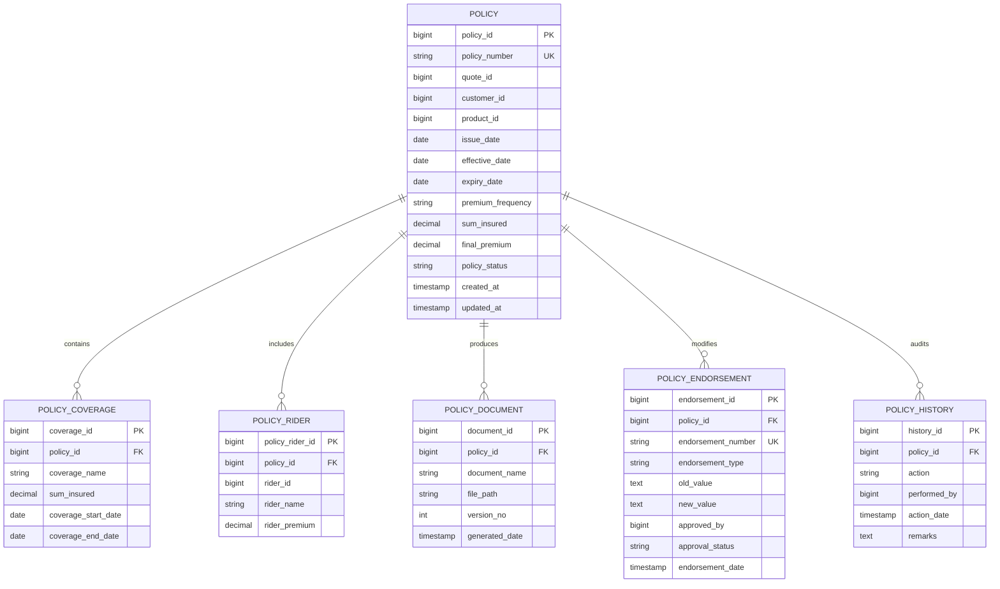
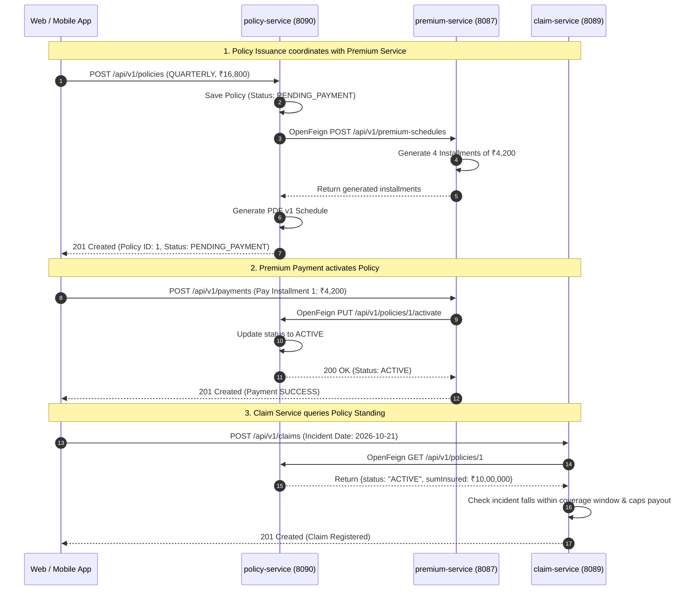

# 📜 Policy Service: Comprehensive Architectural Guide, Real-World Story, Entity Schema & Line-by-Line ServiceImpl Deep Dive

---

## 🌟 Table of Contents
1. [The Real-World Story: The Legal Foundation of Insurance](#1-the-real-world-story-the-legal-foundation-of-insurance)
   - [The Legacy Paper Bond Nightmare vs. The Modern Cloud Issuance](#the-legacy-paper-bond-nightmare-vs-the-modern-cloud-issuance)
   - [Why Policy Service is the Single Source of Truth (SSOT)](#why-policy-service-is-the-single-source-of-truth-ssot)
2. [The 7-Stage Policy Lifecycle & Finite State Machine](#2-the-7-stage-policy-lifecycle--finite-state-machine)
   - [State Transition Diagram](#state-transition-diagram)
   - [State Definitions & Insurance Law Mandates (Section 64VB)](#state-definitions--insurance-law-mandates-section-64vb)
3. [Comprehensive Entity Architecture (The Data Core)](#3-comprehensive-entity-architecture-the-data-core)
   - [1. Policy Entity (INS030 - Master Contract Header)](#1-policy-entity-ins030---master-contract-header)
   - [2. PolicyCoverage Entity (INS031 - Modular Benefits)](#2-policycoverage-entity-ins031---modular-benefits)
   - [3. PolicyRider Entity (INS032 - Add-On Benefits)](#3-policyrider-entity-ins032---add-on-benefits)
   - [4. PolicyDocument Entity (INS033 - Versioned PDF Schedules)](#4-policydocument-entity-ins033---versioned-pdf-schedules)
   - [5. PolicyEndorsement Entity (INS034 - Mid-Term Contract Alterations)](#5-policyendorsement-entity-ins034---mid-term-contract-alterations)
   - [6. PolicyHistory Entity (INS035 - Immutable Regulatory Audit Ledger)](#6-policyhistory-entity-ins035---immutable-regulatory-audit-ledger)
4. [Master Endpoints Directory (Operational Sequence)](#4-master-endpoints-directory-operational-sequence)
5. [Phase-by-Phase Line-by-Line ServiceImpl Business Logic Deep Dive](#5-phase-by-phase-line-by-line-serviceimpl-business-logic-deep-dive)
   - [Phase 1: Policy Issuance & Contract Minting (PolicyServiceImpl.issuePolicy)](#phase-1-policy-issuance--contract-minting-policyserviceimplissuepolicy)
   - [Phase 2: Policy Inquiries & Search (getAllPolicies & getPolicyById)](#phase-2-policy-inquiries--search-getallpolicies--getpolicybyid)
   - [Phase 3: Term Updates & Early Cancellations (updatePolicy & cancelPolicy)](#phase-3-term-updates--early-cancellations-updatepolicy--cancelpolicy)
   - [Phase 4: Regulatory State Transitions (activatePolicy, suspendPolicy, expirePolicy)](#phase-4-regulatory-state-transitions-activatepolicy-suspendpolicy-expirepolicy)
   - [Phase 5: Document Versioning & PDF Schedule Regeneration (PolicyDocumentServiceImpl)](#phase-5-document-versioning--pdf-schedule-regeneration-policydocumentserviceimpl)
   - [Phase 6: Mid-Term Contract Endorsements (PolicyEndorsementServiceImpl)](#phase-6-mid-term-contract-endorsements-policyendorsementserviceimpl)
6. [Cross-Service OpenFeign Coordination](#6-cross-service-openfeign-coordination)
   - [Coordination 1: Policy Service ➔ Premium Service (Schedule Generation)](#coordination-1-policy-service--premium-service-schedule-generation)
   - [Coordination 2: Premium Service ➔ Policy Service (Automatic Activation)](#coordination-2-premium-service--policy-service-automatic-activation)
   - [Coordination 3: Claim Service ➔ Policy Service (Standing & Coverage Verification)](#coordination-3-claim-service--policy-service-standing--coverage-verification)
7. [Step-by-Step Postman Testing Walkthrough](#7-step-by-step-postman-testing-walkthrough)
8. [Senior Developer Viva & Architecture Defense Cheat Sheet](#8-senior-developer-viva--architecture-defense-cheat-sheet)

---

## 1. The Real-World Story: The Legal Foundation of Insurance

### 📖 The Story of Dr. Priya Nair: A Family Health Policy in Bangalore

It is Monday morning in Bangalore. **Dr. Priya Nair**, a 36-year-old pediatrician, decides to purchase a comprehensive health insurance policy covering herself, her husband Arun, and their 4-year-old daughter Ananya. She goes online, compares options, and configures a customized policy:
- **Base Inpatient Hospitalization Cover**: ₹10,00,000 Sum Insured.
- **Critical Illness Cover**: ₹5,00,000 Sum Insured.
- **Hospital Daily Cash Rider**: ₹2,500/day for unexpected ancillary expenses.
- **Quarterly Premium Installments**: She prefers paying ₹4,200 every 3 months rather than ₹16,800 upfront.

When Priya taps **"Proceed to Issue Policy"**, she isn't just buying an e-commerce product like a pair of shoes. Under insurance law, she is entering into an **aleatory legal contract of utmost good faith (*Uberrima Fides*)**.

The insurance company agrees: *In exchange for Priya's timely premium payments, the insurer accepts the legal liability to pay up to ₹10,00,000 if Priya or her family suffers a medical emergency between October 22, 2026, and October 21, 2027.*

---

### The Legacy Paper Bond Nightmare vs. The Modern Cloud Issuance

#### ❌ The Legacy Insurance Nightmare (How It Used to Work)
1. **The 3-Week Paper Bond Delay**: Priya fills out a physical 8-page proposal form. The physical paper travels through courier to an operations center in another city. Three weeks later, a printed policy bond arrives by post.
2. **Missing Riders & Typographical Errors**: Priya checks the printed bond. Her daughter's name is misspelled as *"Ananyaa"* instead of *"Ananya"*, and the agent forgot to include the Hospital Daily Cash rider she paid for.
3. **The Endorsement Nightmare**: To fix the name typo, Priya must write a physical letter, attach notary-attested birth certificates, visit a branch office, and wait 45 days for an endorsement slip to be stamped.
4. **Disconnected Systems**: When Priya visits a hospital, the hospital's TPA desk rejects cashless hospitalization because the insurer's claims department is looking at an outdated database that hasn't synced with the policy branch file!

---

#### ✅ The Modern AMPTA Microservices Flow (How Our System Works)
1. **Sub-Second Policy Minting**: When Priya clicks *"Issue Policy"*, the frontend calls `POST /api/v1/policies` on our **`policy-service`**.
   - In less than **90 milliseconds**, `policy-service` mints a structured policy number: `HLT-KA-2026-104829`.
   - It persists the contract header, base coverages, and optional riders in transactional isolation.
   - Initial status is set to `PENDING_PAYMENT` (risk has not attached yet).
2. **Automated Inter-Service Premium Coordination via OpenFeign**:
   - `policy-service` immediately fires a Feign client call to **`premium-service`** (`POST /api/v1/premium-schedules`).
   - `premium-service` calculates 4 quarterly installment schedules of ₹4,200 each, setting due dates exactly 3 months apart.
3. **Instant PDF Schedule Generation**:
   - `PolicyDocumentServiceImpl` dynamically creates `Policy_Schedule_HLT-KA-2026-104829_v1.pdf`, listing the policyholder, covered dependents, coverage limits, and terms.
4. **Instant Self-Service Endorsement**:
   - When Priya spots an address update or nominee correction 3 months later, she files a digital endorsement request (`POST /api/v1/policies/1/endorsements`).
   - The underwriter approves it with one click. The policy document automatically bumps from `v1` to `v2` (`Policy_Schedule_..._v2.pdf`), preserving an immutable historical record of who changed what, when, and why.
5. **Seamless Ecosystem Integration**:
   - When Priya pays her first premium installment, `premium-service` calls `policy-service`'s `PUT /api/v1/policies/1/activate` via OpenFeign. Status shifts instantly to `ACTIVE`.
   - When Priya later claims for hospital admission, `claim-service` queries `policy-service` via OpenFeign to verify that Priya's policy is `ACTIVE` and that the claim falls within her ₹10,00,000 sum insured limit.

---

### Why Policy Service is the Single Source of Truth (SSOT)

In a distributed insurance microservice architecture:
- `quote-service` is ephemeral: Once a quote is accepted, its job is done.
- `underwriting-service` is evaluative: It assesses risk score and approves terms.
- `premium-service` is transactional: It tracks money due and money paid.
- `claim-service` is reactionary: It disburses money when an event occurs.
- **`policy-service` is the Master Contract Repository (Single Source of Truth).**

Every other microservice queries `policy-service`:
- Claims asks: *"Is this policy active? What is the sum insured? Was the accident date inside the contract window?"*
- Premium asks: *"What is the premium frequency? What is the total annual premium?"*
- Customer asks: *"How many active policies does customer #501 hold?"*
- Reports asks: *"What is our total gross written premium (GWP) and active book value?"*

If `policy-service` data is corrupted or out of sync, the entire insurance enterprise suffers catastrophic financial and legal consequences.

---

## 2. The 7-Stage Policy Lifecycle & Finite State Machine

An insurance policy is not a static database row. It is a strictly governed **Finite State Machine (FSM)** aligned with international insurance law and regulatory standards.

### State Transition Diagram



---

### State Definitions & Insurance Law Mandates (Section 64VB)

| State | Who Triggers It? | Meaning in the Real World |
| :--- | :--- | :--- |
| **`DRAFT`** | Proposal Engine / Agent | The customer has configured coverages and riders, but the policy contract has not yet been legally generated or signed. |
| **`PENDING_PAYMENT`** | `PolicyServiceImpl.issuePolicy` | **The Policy is Issued but Inactive**. Under **Section 64VB of the Insurance Act**, risk *never* attaches until the insurer receives the premium. The contract exists, schedules are generated in `premium-service`, but claims are blocked. |
| **`ACTIVE`** | `premium-service` via OpenFeign | **The Golden State**. The initial premium has been successfully collected. The insurer is on risk. The customer is fully covered. Claims are admissible. |
| **`SUSPENDED`** | Premium Overdue Scheduler | An installment was not paid within the statutory 30-day grace period. Coverage is temporarily frozen. If an accident occurs while suspended, claims are non-payable. Once the customer pays, status returns to `ACTIVE`. |
| **`CANCELLED`** | Customer / Operations | The policy is cancelled prior to maturity (e.g., during the 15-day Free-Look Period, or for non-payment, or upon customer request). Pro-rata unearned premium is calculated and sent to `premium-service` for refund. |
| **`EXPIRED`** | Policy Expiry Scheduler | The contract has reached its natural term end (e.g., 1 year from effective date). Coverage ceases unless renewed. |
| **`CLOSED`** | Finance & Actuarial Dept | All accounting reserves, reinsurance cessions, and pending claims for this policy year are fully liquidated and archived into deep storage. |

---

## 3. Comprehensive Entity Architecture (The Data Core)

Our `policy-service` is architected with **6 dedicated database entities**, creating a robust relational schema with strict indexing, foreign keys, and auditability.



---

### 1. Policy Entity (`INS030` - Master Contract Header)
- **Table Name**: `policy`
- **Class**: `com.ampta.policyservice.entity.Policy`
- **Indexes**:
  - `idx_policy_number` on `policy_number` (**UNIQUE**) — guarantees fast lookup when customer quotes policy number.
  - `idx_policy_quote` on `quote_id` — links back to originating quotation.
  - `idx_policy_customer` on `customer_id` — enables sub-millisecond retrieval of all policies held by a customer.
  - `idx_policy_status` on `policy_status` — enables batch scheduler jobs to rapidly query all `ACTIVE` or `SUSPENDED` policies.

#### Detailed Field Specifications:
| Field Name | Type | Constraints | Real-World Business Purpose |
| :--- | :--- | :--- | :--- |
| **`policyId`** | `Long` | `PRIMARY KEY`, Auto-Increment | Internal surrogate database identifier. |
| **`policyNumber`** | `String` | `NOT NULL`, `UNIQUE`, Length: 50 | Structured legal identifier (e.g., `HLT-KA-2026-104829`) presented on insurance cards and hospital admission forms. |
| **`quoteId`** | `Long` | `NOT NULL` | Traceability back to the original underwriting risk assessment and pricing calculation. |
| **`customerId`** | `Long` | `NOT NULL` | Foreign key referencing the policyholder in `customer-service`. |
| **`productId`** | `Long` | `NOT NULL` | Foreign key referencing the insurance product (e.g., *Comprehensive Health Plan Platinum*) in `product-service`. |
| **`issueDate`** | `LocalDate` | `NOT NULL` | The exact calendar date on which the policy contract was formally drafted and stamped. |
| **`effectiveDate`** | `LocalDate` | `NOT NULL` | The date from which coverage begins (policy start date). Claims before this date are inadmissible. |
| **`expiryDate`** | `LocalDate` | `NOT NULL` | The date on which coverage terminates (usually 1 year, 2 years, or 3 years from effective date). |
| **`premiumFrequency`**| `String` | `NOT NULL`, Length: 30 | Frequency of premium payment: `MONTHLY`, `QUARTERLY`, `HALF_YEARLY`, `YEARLY`, `SINGLE`. Used by `premium-service` to break down installments. |
| **`sumInsured`** | `BigDecimal` | `NOT NULL`, Precision: (15,2) | Maximum financial liability undertaken by the insurer (e.g., ₹10,00,000.00). Claims cannot exceed this ceiling. |
| **`finalPremium`** | `BigDecimal` | `NOT NULL`, Precision: (15,2) | Total annual premium payable by the customer, inclusive of base coverage, add-on riders, taxes, and discounts. |
| **`policyStatus`** | `PolicyStatus`| `NOT NULL`, Length: 30 | Current lifecycle state: `DRAFT`, `PENDING_PAYMENT`, `ACTIVE`, `SUSPENDED`, `CANCELLED`, `EXPIRED`, `CLOSED`. |
| **`createdAt`** | `LocalDateTime`| `updatable = false` | Audit timestamp when the database record was inserted. |
| **`updatedAt`** | `LocalDateTime`| Auto-updated | Audit timestamp when any field was last modified. |

---

### 2. PolicyCoverage Entity (`INS031` - Modular Benefits)
- **Table Name**: `policy_coverage`
- **Class**: `com.ampta.policyservice.entity.PolicyCoverage`
- **Why Separate from Base Policy?**: Modern insurance contracts are modular. A single Health Policy does not just have a single blanket amount; it breaks down into specific coverage heads with their own sub-limits:
  1. *Base Inpatient Hospitalization*: ₹8,00,000 Sum Insured.
  2. *Daycare Procedures (Cataract, Dialysis)*: ₹1,00,000 Sum Insured.
  3. *Critical Illness Cover*: ₹2,00,000 Sum Insured.
  4. *Ambulance Cover*: ₹10,000 Sum Insured.

#### Detailed Field Specifications:
| Field Name | Type | Constraints | Real-World Business Purpose |
| :--- | :--- | :--- | :--- |
| **`coverageId`** | `Long` | `PRIMARY KEY`, Auto-Increment | Unique identifier of this coverage item. |
| **`policyId`** | `Long` | `NOT NULL`, Indexed | Foreign key linking to parent `policy.policy_id`. |
| **`coverageName`** | `String` | `NOT NULL`, Length: 150 | Descriptive name of the insured peril or benefit (e.g., *"Critical Illness Cover"*). |
| **`sumInsured`** | `BigDecimal` | `NOT NULL`, Precision: (15,2) | Specific financial limit applicable to this individual coverage item. |
| **`coverageStartDate`** | `LocalDate` | Defaults to policy effective date | Start date for this specific benefit. Allows delayed attachment (e.g., maternity coverage attaching after a 9-month waiting period). |
| **`coverageEndDate`** | `LocalDate` | Defaults to policy expiry date | End date for this specific benefit. |

---

### 3. PolicyRider Entity (`INS032` - Add-On Benefits)
- **Table Name**: `policy_rider`
- **Class**: `com.ampta.policyservice.entity.PolicyRider`
- **What is a Rider?**: A rider is an optional, supplementary contract endorsement that the policyholder pays an extra premium for to enhance their core coverage:
  - *Motor Insurance*: Zero Depreciation Rider, Engine Protector, Consumables Cover, Roadside Assistance.
  - *Health Insurance*: Hospital Daily Cash, International Emergency Cover, OPD Doctor Visit Cover.
  - *Life Insurance*: Accidental Death Benefit, Waiver of Premium on Critical Illness.

#### Detailed Field Specifications:
| Field Name | Type | Constraints | Real-World Business Purpose |
| :--- | :--- | :--- | :--- |
| **`policyRiderId`** | `Long` | `PRIMARY KEY`, Auto-Increment | Unique identifier of the attached rider. |
| **`policyId`** | `Long` | `NOT NULL`, Indexed | Foreign key linking to parent `policy.policy_id`. |
| **`riderId`** | `Long` | `NOT NULL` | Catalog identifier of the rider in `product-service`. |
| **`riderName`** | `String` | `NOT NULL`, Length: 150 | Commercial name of the rider (e.g., *"Hospital Daily Cash Rider"*). |
| **`riderPremium`** | `BigDecimal` | `NOT NULL`, Precision: (15,2) | Extra premium charged specifically for this add-on benefit (e.g., ₹500.00). |

---

### 4. PolicyDocument Entity (`INS033` - Versioned PDF Schedules)
- **Table Name**: `policy_document`
- **Class**: `com.ampta.policyservice.entity.PolicyDocument`
- **Why Versioning Matters**: An insurance schedule is a legal instrument. If Dr. Priya changes her address or nominee in Month 4, the insurer cannot simply overwrite the old PDF file. The original contract bond is `v1`. The endorsed contract bond is `v2`. If a dispute goes to an insurance ombudsman or court, the exact legal document in force on the date of accident must be retrievable.

#### Detailed Field Specifications:
| Field Name | Type | Constraints | Real-World Business Purpose |
| :--- | :--- | :--- | :--- |
| **`documentId`** | `Long` | `PRIMARY KEY`, Auto-Increment | Unique identifier of the document record. |
| **`policyId`** | `Long` | `NOT NULL`, Indexed | Foreign key linking to parent `policy.policy_id`. |
| **`documentName`** | `String` | `NOT NULL`, Length: 200 | Filename (e.g., `Policy_Schedule_HLT-KA-2026-104829_v1.pdf`). |
| **`filePath`** | `String` | `NOT NULL`, Length: 500 | Storage URI / S3 path / local filesystem path to the compiled PDF file. |
| **`versionNo`** | `Integer` | `NOT NULL`, Default: 1 | Monotonically increasing version counter (`1`, `2`, `3`...). Incremented upon every approved endorsement. |
| **`generatedDate`** | `LocalDateTime`| `updatable = false` | Exact timestamp when the PDF was compiled and digitally stamped. |

---

### 5. PolicyEndorsement Entity (`INS034` - Mid-Term Alterations)
- **Table Name**: `policy_endorsement`
- **Class**: `com.ampta.policyservice.entity.PolicyEndorsement`
- **What is an Endorsement?**: In insurance terminology, an **Endorsement** (or policy rider alteration) is any agreed modification made to a policy contract *after* it has been issued and during its active term.
  - *Non-Financial Endorsements*: Address change, correction of spelling in name, change of nominee, change of contact phone number.
  - *Financial Endorsements*: Increasing the sum insured mid-term, adding a newly born infant to the family floater, adding a zero-depreciation rider.
- **The Four-Eyes Principle**: A customer or junior clerk requests an endorsement. The status is `PENDING`. An underwriting manager reviews and executes `approveEndorsement` or `rejectEndorsement`.

#### Detailed Field Specifications:
| Field Name | Type | Constraints | Real-World Business Purpose |
| :--- | :--- | :--- | :--- |
| **`endorsementId`** | `Long` | `PRIMARY KEY`, Auto-Increment | Internal surrogate identifier. |
| **`policyId`** | `Long` | `NOT NULL`, Indexed | Foreign key linking to parent `policy.policy_id`. |
| **`endorsementNumber`**| `String` | `NOT NULL`, `UNIQUE`, Length: 50 | Structured tracking code (e.g., `END-2026-904128`). |
| **`endorsementType`** | `EndorsementType`| `NOT NULL`, Length: 100 | Enum: `ADDRESS_CHANGE`, `NOMINEE_CHANGE`, `COVERAGE_INCREASE`, `COVERAGE_DECREASE`, `RIDER_ADDITION`, `RIDER_REMOVAL`, `NAME_CORRECTION`. |
| **`oldValue`** | `String` | `TEXT` | Pre-modification state (e.g., *"Nominee: Arun Nair (Spouse), Share: 100%"*). |
| **`newValue`** | `String` | `TEXT` | Proposed post-modification state (e.g., *"Nominee: Ananya Nair (Daughter), Share: 100%"*). |
| **`approvedBy`** | `Long` | Nullable | User ID of the Underwriting Manager who authorized or rejected the alteration. |
| **`approvalStatus`** | `EndorsementStatus`| `NOT NULL`, Default: `PENDING`| Enum: `PENDING`, `APPROVED`, `REJECTED`. |
| **`endorsementDate`** | `LocalDateTime`| `updatable = false` | Audit timestamp when the endorsement request was lodged. |

---

### 6. PolicyHistory Entity (`INS035` - Immutable Regulatory Audit Ledger)
- **Table Name**: `policy_history`
- **Class**: `com.ampta.policyservice.entity.PolicyHistory`
- **Why Immutability Matters**: Under insurance regulatory compliance (IRDAI, FCA, HIPAA, Sarbanes-Oxley), insurance records can never be silently updated or overwritten. Any state change—whether an automatic status activation, a manual cancellation, an address change, or a suspension—must be permanently appended to this chronological audit ledger.

#### Detailed Field Specifications:
| Field Name | Type | Constraints | Real-World Business Purpose |
| :--- | :--- | :--- | :--- |
| **`historyId`** | `Long` | `PRIMARY KEY`, Auto-Increment | Unique sequence number. |
| **`policyId`** | `Long` | `NOT NULL`, Indexed | Foreign key linking to parent `policy.policy_id`. |
| **`action`** | `String` | `NOT NULL`, Length: 100 | Descriptive action tag: `"Policy Issued"`, `"Policy Activated"`, `"Policy Suspended"`, `"Endorsement Approved"`, `"Policy Cancelled"`. |
| **`performedBy`** | `Long` | `NOT NULL` | User ID of the actor (customer, underwriting officer, or system scheduler `1L`). |
| **`actionDate`** | `LocalDateTime`| `updatable = false` | Millisecond-accurate timestamp of the action. |
| **`remarks`** | `String` | `TEXT` | Full contextual explanation for the action. |

---

## 4. Master Endpoints Directory (Operational Sequence)

| Step # | HTTP Method | Endpoint URL | Controller | Primary Business Function |
| :---: | :--- | :--- | :--- | :--- |
| **1** | `POST` | `/api/v1/policies` | `PolicyController` | **Issue Policy**: Mints contract, saves coverages & riders, coordinates installment generation with `premium-service` via OpenFeign, builds PDF v1. |
| **2** | `GET` | `/api/v1/policies` | `PolicyController` | **List Policies**: Queries active policies with optional filtering by `status` or `customerId`. |
| **3** | `GET` | `/api/v1/policies/{id}` | `PolicyController` | **Get Policy Details**: Returns comprehensive policy dossier including nested coverages and riders. |
| **4** | `PUT` | `/api/v1/policies/{id}` | `PolicyController` | **Update Policy Dates**: Adjusts effective or expiry dates before activation; logs history. |
| **5** | `DELETE` | `/api/v1/policies/{id}` | `PolicyController` | **Cancel Policy**: Cancels policy contract; transitions status to `CANCELLED`. |
| **6** | `PUT` | `/api/v1/policies/{id}/activate` | `PolicyController` | **Activate Policy**: State transition to `ACTIVE` upon successful initial premium payment (called by `premium-service` via Feign). |
| **7** | `PUT` | `/api/v1/policies/{id}/suspend` | `PolicyController` | **Suspend Policy**: State transition to `SUSPENDED` when premiums are unpaid past the 30-day grace period. |
| **8** | `PUT` | `/api/v1/policies/{id}/expire` | `PolicyController` | **Expire Policy**: State transition to `EXPIRED` upon reaching policy term end. |
| **9** | `GET` | `/api/v1/policies/{id}/document` | `PolicyDocumentController` | **Get Policy Document**: Fetches current active PDF schedule URI and version number. |
| **10** | `POST` | `/api/v1/policies/{id}/document/regenerate` | `PolicyDocumentController` | **Regenerate Schedule**: Recompiles PDF schedule, increments version (`v1` ➔ `v2`). |
| **11** | `POST` | `/api/v1/policies/{id}/endorsements` | `PolicyEndorsementController` | **Request Endorsement**: Lodges mid-term alteration request; sets status `PENDING`. |
| **12** | `GET` | `/api/v1/policies/{id}/endorsements` | `PolicyEndorsementController` | **List Endorsements**: Fetches all mid-term alteration records for a policy. |
| **13** | `PUT` | `/api/v1/endorsements/{endorsementId}/approve` | `PolicyEndorsementController` | **Approve Endorsement**: Manager authorizes change; auto-regenerates PDF schedule to next version. |
| **14** | `PUT` | `/api/v1/endorsements/{endorsementId}/reject` | `PolicyEndorsementController` | **Reject Endorsement**: Manager rejects alteration with mandatory audit remarks. |

---

## 5. Phase-by-Phase Line-by-Line ServiceImpl Business Logic Deep Dive

---

### Phase 1: Policy Issuance & Contract Minting (`PolicyServiceImpl.issuePolicy`)

#### Endpoint: `POST /api/v1/policies`
- **Controller**: `PolicyController.issuePolicy`
- **Request DTO**: `PolicyIssueRequestDto`
- **Response DTO**: `PolicyResponseDto`

#### The Complete Source Code: `PolicyServiceImpl.issuePolicy`
```java
@Override
public PolicyResponseDto issuePolicy(PolicyIssueRequestDto request) {
    // Check 1: Date Logic Validation
    if (request.getEffectiveDate().isAfter(request.getExpiryDate())) {
        throw new BusinessException("Effective date cannot be after expiry date.");
    }

    // Step 1: Generate Structured Business Policy Number (Format: {PROD}-{STATE}-{YEAR}-{SEQUENCE})
    String prod = request.getProductCode() != null ? request.getProductCode().toUpperCase() : "POL";
    String state = request.getStateCode() != null ? request.getStateCode().toUpperCase() : "IN";
    String year = String.valueOf(LocalDate.now().getYear());
    String seq = String.format("%06d", System.currentTimeMillis() % 1000000);
    String policyNumber = prod + "-" + state + "-" + year + "-" + seq;

    // Step 2: Persist Policy Entity Header
    Policy policy = Policy.builder()
            .policyNumber(policyNumber)
            .quoteId(request.getQuoteId())
            .customerId(request.getCustomerId())
            .productId(request.getProductId())
            .issueDate(LocalDate.now())
            .effectiveDate(request.getEffectiveDate())
            .expiryDate(request.getExpiryDate())
            .premiumFrequency(request.getPremiumFrequency())
            .sumInsured(request.getSumInsured())
            .finalPremium(request.getFinalPremium())
            .policyStatus(PolicyStatus.PENDING_PAYMENT)
            .build();

    Policy savedPolicy = policyRepository.save(policy);

    // Step 3: Persist Coverages Child Records
    if (request.getCoverages() != null) {
        List<PolicyCoverage> coverages = request.getCoverages().stream().map(c -> PolicyCoverage.builder()
                .policyId(savedPolicy.getPolicyId())
                .coverageName(c.getCoverageName())
                .sumInsured(c.getSumInsured())
                .coverageStartDate(c.getCoverageStartDate() != null ? c.getCoverageStartDate() : savedPolicy.getEffectiveDate())
                .coverageEndDate(c.getCoverageEndDate() != null ? c.getCoverageEndDate() : savedPolicy.getExpiryDate())
                .build()).collect(Collectors.toList());
        coverageRepository.saveAll(coverages);
    }

    // Step 4: Persist Riders Child Records
    if (request.getRiders() != null) {
        List<PolicyRider> riders = request.getRiders().stream().map(r -> PolicyRider.builder()
                .policyId(savedPolicy.getPolicyId())
                .riderId(r.getRiderId())
                .riderName(r.getRiderName())
                .riderPremium(r.getRiderPremium())
                .build()).collect(Collectors.toList());
        riderRepository.saveAll(riders);
    }

    // Step 5: Trigger Installment Schedule Generation in Premium Service via OpenFeign
    try {
        int termMonths = request.getPolicyTermMonths() != null && request.getPolicyTermMonths() > 0
                ? request.getPolicyTermMonths() : 12;

        ScheduleRequestDto scheduleReq = ScheduleRequestDto.builder()
                .policyId(savedPolicy.getPolicyId())
                .policyTermMonths(termMonths)
                .premiumFrequency(request.getPremiumFrequency())
                .startDate(savedPolicy.getEffectiveDate())
                .finalPremium(savedPolicy.getFinalPremium())
                .build();

        premiumClient.generateSchedules(scheduleReq);
        log.info("Coordinated installment schedule generation with premium-service for policy: {}", policyNumber);
    } catch (Exception e) {
        log.warn("Could not coordinate schedule with premium-service: {}", e.getMessage());
    }

    // Step 6: Generate Initial PDF Policy Document Schedule (Version 1)
    documentService.regeneratePolicyDocument(savedPolicy.getPolicyId());

    // Step 7: Record Immutable History Audit
    recordHistory(savedPolicy.getPolicyId(), "Policy Issued", 1L, "Policy contract issued. Awaiting first premium payment.");

    return toDto(savedPolicy);
}
```

#### Line-by-Line & Block-by-Block Explanation:
- **`if (request.getEffectiveDate().isAfter(request.getExpiryDate()))`**:
  - *Why this check is vital*: A policy cannot start after it expires! If a policy starts on `2026-10-21` and ends on `2025-10-21`, it violates time-consistency. Throws `BusinessException` with HTTP 400.
- **`String policyNumber = prod + "-" + state + "-" + year + "-" + seq;`**:
  - *The Structured Policy Number Format*: In insurance enterprise systems, raw autoincrement primary keys like `14` are meaningless to customers, hospitals, and police departments. Our service generates an industry-standard structured code:
    - `{PROD}`: Product category code (`HLT` for Health, `MTR` for Motor, `LIFE` for Life).
    - `{STATE}`: Two-letter state regulatory jurisdiction code (`KA` for Karnataka, `MH` for Maharashtra, `DL` for Delhi).
    - `{YEAR}`: The issue year (`2026`).
    - `{SEQUENCE}`: A 6-digit timestamp-backed unique sequence (e.g., `104829`).
    - Result: `HLT-KA-2026-104829`.
- **`policyStatus(PolicyStatus.PENDING_PAYMENT)`**:
  - Under Section 64VB of the Insurance Act, an insurer cannot issue an `ACTIVE` policy on credit. The policy is issued in `PENDING_PAYMENT` state. Risk will only attach once `premium-service` confirms money has been received.
- **`coverageStartDate != null ? ... : savedPolicy.getEffectiveDate()`**:
  - Coverages inherit the policy start and end dates by default, but allow custom dates for riders with waiting periods.
- **`premiumClient.generateSchedules(scheduleReq)`**:
  - *The Inter-Service Feign Call*: `policy-service` does not handle billing calculations. It sends a message via Spring Cloud OpenFeign to `premium-service` (`POST /api/v1/premium-schedules`), passing `policyId`, `policyTermMonths: 12`, `premiumFrequency: "QUARTERLY"`, and `finalPremium: 16800.00`.
  - `premium-service` automatically splits this into 4 quarterly installments of ₹4,200 each, spaced exactly 3 months apart, and saves them in the `premium_schedule` database!
- **`documentService.regeneratePolicyDocument(...)`**:
  - Instantly compiles the official digital policy schedule `Policy_Schedule_HLT-KA-2026-104829_v1.pdf`.
- **`recordHistory(...)`**:
  - Writes the initial entry to `policy_history`.

---

### Phase 2: Policy Inquiries & Search (`getAllPolicies` & `getPolicyById`)

#### Endpoints:
- `GET /api/v1/policies`
- `GET /api/v1/policies/{id}`

#### Code Deep Dive: `PolicyServiceImpl.getAllPolicies` & `getPolicyById`
```java
@Override
@Transactional(readOnly = true)
public List<PolicyResponseDto> getAllPolicies(PolicyStatus status, Long customerId) {
    List<Policy> list;
    if (customerId != null) {
        list = policyRepository.findByCustomerId(customerId);
    } else if (status != null) {
        list = policyRepository.findByPolicyStatus(status);
    } else {
        list = policyRepository.findAll();
    }
    return list.stream().map(this::toDto).collect(Collectors.toList());
}

@Override
@Transactional(readOnly = true)
public PolicyResponseDto getPolicyById(Long policyId) {
    Policy policy = policyRepository.findById(policyId)
            .orElseThrow(() -> new ResourceNotFoundException("Policy not found with ID: " + policyId));
    return toDto(policy);
}
```

#### Line-by-Line Explanation:
- **`@Transactional(readOnly = true)`**:
  - Tells Hibernate and Spring that this database interaction will only read data. Hibernate turns off dirty-checking and snapshot creation, dramatically reducing CPU and memory overhead during high-concurrency read spikes.
- **`if (customerId != null) ... else if (status != null)`**:
  - Flexible multi-criteria query optimization. Allows customer self-service portals to fetch all policies for customer #501 (`?customerId=501`), or operational dashboards to query all suspended policies (`?status=SUSPENDED`).
- **`toDto(Policy p)`**:
  - Assembles the complete response DTO by querying the child `coverageRepository` and `riderRepository` for the given policy ID, returning a rich, fully populated contract object.

---

### Phase 3: Term Updates & Early Cancellations (`updatePolicy` & `cancelPolicy`)

#### Endpoints:
- `PUT /api/v1/policies/{id}`
- `DELETE /api/v1/policies/{id}`

#### Code Deep Dive: `PolicyServiceImpl.updatePolicy` & `cancelPolicy`
```java
@Override
public PolicyResponseDto updatePolicy(Long policyId, PolicyUpdateDto request) {
    Policy policy = policyRepository.findById(policyId)
            .orElseThrow(() -> new ResourceNotFoundException("Policy not found with ID: " + policyId));

    // Guard Clause: Prevent modification of dead policies
    if (policy.getPolicyStatus() == PolicyStatus.CANCELLED || policy.getPolicyStatus() == PolicyStatus.CLOSED) {
        throw new BusinessException("Cannot modify cancelled or closed policies.");
    }

    if (request.getEffectiveDate() != null) {
        policy.setEffectiveDate(request.getEffectiveDate());
    }
    if (request.getExpiryDate() != null) {
        policy.setExpiryDate(request.getExpiryDate());
    }

    Policy updated = policyRepository.save(policy);
    recordHistory(policyId, "Policy Updated", 1L, request.getRemarks() != null ? request.getRemarks() : "Terms updated.");
    return toDto(updated);
}

@Override
public void cancelPolicy(Long policyId) {
    Policy policy = policyRepository.findById(policyId)
            .orElseThrow(() -> new ResourceNotFoundException("Policy not found with ID: " + policyId));

    policy.setPolicyStatus(PolicyStatus.CANCELLED);
    policyRepository.save(policy);
    recordHistory(policyId, "Policy Cancelled", 1L, "Policy cancelled by operations.");
}
```

#### Line-by-Line Explanation:
- **`if (policy.getPolicyStatus() == PolicyStatus.CANCELLED || policy.getPolicyStatus() == PolicyStatus.CLOSED)`**:
  - *Defensive Guard Clause*: A cancelled or closed policy is a terminated legal contract. Modifying its dates would expose the insurer to severe legal liabilities and fraud. Throws `BusinessException`.
- **Soft Deletion Architecture**:
  - Notice that `cancelPolicy` does **NOT** execute `DELETE FROM policy`. Physical deletion of insurance contracts is illegal under financial data preservation laws. The record is preserved with `policyStatus = CANCELLED`, and an immutable entry is logged in `policy_history`.

---

### Phase 4: Regulatory State Transitions (`activatePolicy`, `suspendPolicy`, `expirePolicy`)

#### Endpoints:
- `PUT /api/v1/policies/{id}/activate`
- `PUT /api/v1/policies/{id}/suspend`
- `PUT /api/v1/policies/{id}/expire`

#### Code Deep Dive: `PolicyServiceImpl`
```java
@Override
public PolicyResponseDto activatePolicy(Long policyId) {
    Policy policy = policyRepository.findById(policyId)
            .orElseThrow(() -> new ResourceNotFoundException("Policy not found with ID: " + policyId));

    policy.setPolicyStatus(PolicyStatus.ACTIVE);
    Policy updated = policyRepository.save(policy);
    recordHistory(policyId, "Policy Activated", 1L, "Policy activated upon successful initial premium payment.");
    log.info("Policy ID: {} activated successfully.", policyId);
    return toDto(updated);
}

@Override
public PolicyResponseDto suspendPolicy(Long policyId) {
    Policy policy = policyRepository.findById(policyId)
            .orElseThrow(() -> new ResourceNotFoundException("Policy not found with ID: " + policyId));

    policy.setPolicyStatus(PolicyStatus.SUSPENDED);
    Policy updated = policyRepository.save(policy);
    recordHistory(policyId, "Policy Suspended", 1L, "Policy suspended due to overdue premium non-payment.");
    return toDto(updated);
}

@Override
public PolicyResponseDto expirePolicy(Long policyId) {
    Policy policy = policyRepository.findById(policyId)
            .orElseThrow(() -> new ResourceNotFoundException("Policy not found with ID: " + policyId));

    policy.setPolicyStatus(PolicyStatus.EXPIRED);
    Policy updated = policyRepository.save(policy);
    recordHistory(policyId, "Policy Expired", 1L, "Policy reached end of term.");
    return toDto(updated);
}
```

#### Line-by-Line Explanation:
- **`activatePolicy`**:
  - Called automatically by **`premium-service` via OpenFeign** as soon as the customer successfully pays their first premium installment. Changes status from `PENDING_PAYMENT` to `ACTIVE`. Risk officially attaches!
- **`suspendPolicy`**:
  - Called by automated batch jobs when an installment payment is past due and grace period has elapsed. Suspends coverage to protect the company from paying claims on unpaid policies.
- **`expirePolicy`**:
  - Called when the calendar reaches `expiryDate`. Closes coverage.

---

### Phase 5: Document Versioning & PDF Schedule Regeneration (`PolicyDocumentServiceImpl`)

#### Endpoints:
- `GET /api/v1/policies/{id}/document`
- `POST /api/v1/policies/{id}/document/regenerate`

#### Code Deep Dive: `PolicyDocumentServiceImpl`
```java
@Override
public DocumentResponseDto regeneratePolicyDocument(Long policyId) {
    Policy policy = policyRepository.findById(policyId)
            .orElseThrow(() -> new ResourceNotFoundException("Policy not found with ID: " + policyId));

    // Fetch existing document record or initialize version 0
    PolicyDocument doc = documentRepository.findByPolicyId(policyId)
            .orElseGet(() -> PolicyDocument.builder().policyId(policyId).versionNo(0).build());

    // Increment version counter
    int nextVer = doc.getVersionNo() + 1;
    String docName = "Policy_Schedule_" + policy.getPolicyNumber() + "_v" + nextVer + ".pdf";
    String filePath = "/documents/policies/" + docName;

    doc.setDocumentName(docName);
    doc.setFilePath(filePath);
    doc.setVersionNo(nextVer);
    doc.setGeneratedDate(LocalDateTime.now());

    PolicyDocument saved = documentRepository.save(doc);
    log.info("Policy schedule PDF generated. Document: {}, Version: {}", docName, nextVer);
    return toDto(saved);
}
```

#### Line-by-Line Explanation:
- **`int nextVer = doc.getVersionNo() + 1;`**:
  - *Automated Monotonic Versioning*: When first created at policy issuance, `versionNo = 1` (`Policy_Schedule_..._v1.pdf`).
  - When an endorsement is approved in Month 4 (e.g., nominee change), this method is triggered, automatically creating `v2` (`Policy_Schedule_..._v2.pdf`). Both versions are archived, allowing exact historical reconstruction.

---

### Phase 6: Mid-Term Contract Endorsements (`PolicyEndorsementServiceImpl`)

#### Endpoints:
- `POST /api/v1/policies/{id}/endorsements` (`createEndorsement`)
- `GET /api/v1/policies/{id}/endorsements` (`getEndorsementsByPolicy`)
- `PUT /api/v1/endorsements/{endorsementId}/approve` (`approveEndorsement`)
- `PUT /api/v1/endorsements/{endorsementId}/reject` (`rejectEndorsement`)

#### Code Deep Dive: `PolicyEndorsementServiceImpl`
```java
@Override
public EndorsementResponseDto createEndorsement(Long policyId, EndorsementRequestDto request) {
    Policy policy = policyRepository.findById(policyId)
            .orElseThrow(() -> new ResourceNotFoundException("Policy not found with ID: " + policyId));

    String endNum = "END-" + LocalDate.now().getYear() + "-" + String.format("%06d", System.currentTimeMillis() % 1000000);

    PolicyEndorsement endorsement = PolicyEndorsement.builder()
            .policyId(policyId)
            .endorsementNumber(endNum)
            .endorsementType(request.getEndorsementType())
            .oldValue(request.getOldValue())
            .newValue(request.getNewValue())
            .approvalStatus(EndorsementStatus.PENDING)
            .build();

    PolicyEndorsement saved = endorsementRepository.save(endorsement);

    historyRepository.save(PolicyHistory.builder()
            .policyId(policyId)
            .action("Endorsement Submitted")
            .performedBy(1L)
            .actionDate(LocalDateTime.now())
            .remarks("Endorsement " + endNum + " submitted for " + request.getEndorsementType())
            .build());

    return toDto(saved);
}

@Override
public EndorsementResponseDto approveEndorsement(Long endorsementId, EndorsementApprovalDto request) {
    PolicyEndorsement endorsement = endorsementRepository.findById(endorsementId)
            .orElseThrow(() -> new ResourceNotFoundException("Endorsement not found with ID: " + endorsementId));

    if (endorsement.getApprovalStatus() != EndorsementStatus.PENDING) {
        throw new BusinessException("Endorsement is already processed with status: " + endorsement.getApprovalStatus());
    }

    endorsement.setApprovalStatus(EndorsementStatus.APPROVED);
    endorsement.setApprovedBy(request.getApprovedBy());
    PolicyEndorsement updated = endorsementRepository.save(endorsement);

    // Automatically regenerate policy document to next version upon approval!
    documentService.regeneratePolicyDocument(endorsement.getPolicyId());

    historyRepository.save(PolicyHistory.builder()
            .policyId(endorsement.getPolicyId())
            .action("Endorsement Approved")
            .performedBy(request.getApprovedBy())
            .actionDate(LocalDateTime.now())
            .remarks("Endorsement " + endorsement.getEndorsementNumber() + " approved.")
            .build());

    return toDto(updated);
}
```

#### Line-by-Line Explanation:
- **`approvalStatus(EndorsementStatus.PENDING)`**:
  - Enforces the Four-Eyes principle. An endorsement is not applied immediately; it awaits formal underwriting sign-off.
- **`if (endorsement.getApprovalStatus() != EndorsementStatus.PENDING)`**:
  - Prevents double-processing or replay attacks. Once approved or rejected, an endorsement cannot be re-adjudicated.
- **`documentService.regeneratePolicyDocument(endorsement.getPolicyId())`**:
  - *Automated Contract Regeneration*: The moment the endorsement is approved, the system generates the new versioned PDF schedule reflecting the approved alteration!

---

## 6. Cross-Service OpenFeign Coordination



---

## 7. Step-by-Step Postman Testing Walkthrough

Use the generated Postman collection (`Policy_Service_E2E_Testing.postman_collection.json`) or test manually with these commands:

### Step 1: Issue a Comprehensive Policy
- **POST** `http://localhost:8090/api/v1/policies`
- **Body**:
```json
{
  "quoteId": 201,
  "customerId": 501,
  "productId": 10,
  "productCode": "HLT",
  "stateCode": "KA",
  "effectiveDate": "2026-10-22",
  "expiryDate": "2027-10-21",
  "premiumFrequency": "QUARTERLY",
  "sumInsured": 1000000.00,
  "finalPremium": 16800.00,
  "policyTermMonths": 12,
  "coverages": [
    {
      "coverageName": "Base Inpatient Hospitalization",
      "sumInsured": 800000.00
    },
    {
      "coverageName": "Critical Illness Cover",
      "sumInsured": 200000.00
    }
  ],
  "riders": [
    {
      "riderId": 1,
      "riderName": "Hospital Daily Cash Rider",
      "riderPremium": 500.00
    }
  ]
}
```
- **Expected Status**: `201 Created`
- **Expected Result**: Policy created in `PENDING_PAYMENT` status, policy number minted (e.g. `HLT-KA-2026-XXXXXX`), and 4 installments created in `premium-service`.

---

### Step 2: Get Policy Details
- **GET** `http://localhost:8090/api/v1/policies/1`
- **Expected Status**: `200 OK`
- Returns full policy header with all coverages and riders.

---

### Step 3: Get Generated PDF Schedule
- **GET** `http://localhost:8090/api/v1/policies/1/document`
- **Expected Status**: `200 OK`
- Returns `versionNo: 1` and `documentName: "Policy_Schedule_HLT-KA-2026-XXXXXX_v1.pdf"`.

---

### Step 4: Activate Policy (Simulate Payment via Feign)
- **PUT** `http://localhost:8090/api/v1/policies/1/activate`
- **Expected Status**: `200 OK`
- **Expected Result**: `policyStatus` is now **`ACTIVE`**!

---

### Step 5: Request Mid-Term Endorsement
- **POST** `http://localhost:8090/api/v1/policies/1/endorsements`
- **Body**:
```json
{
  "endorsementType": "NOMINEE_CHANGE",
  "oldValue": "Nominee: Arun Nair (Spouse), Share: 100%",
  "newValue": "Nominee: Ananya Nair (Daughter), Share: 100%"
}
```
- **Expected Status**: `201 Created`
- Endorsement created with status `PENDING`.

---

### Step 6: Approve Endorsement (Four-Eyes Principle)
- **PUT** `http://localhost:8090/api/v1/endorsements/1/approve`
- **Body**:
```json
{
  "approvedBy": 88,
  "remarks": "Birth certificate verified. Nominee change approved."
}
```
- **Expected Status**: `200 OK`
- Endorsement status shifts to `APPROVED`, and policy document automatically regenerates to **`versionNo: 2`**!

---

### Step 7: Verify Increment on PDF Document
- **GET** `http://localhost:8090/api/v1/policies/1/document`
- **Expected Result**: `versionNo: 2` and `documentName: "Policy_Schedule_HLT-KA-2026-XXXXXX_v2.pdf"`!

---

## 8. Senior Developer Viva & Architecture Defense Cheat Sheet

| Question | Model Senior Developer Answer |
| :--- | :--- |
| **Q1: Why is `policy_coverage` a separate table from `policy`?** | *"Insurance products are modular. Normalizing coverages into a one-to-many relationship allows distinct sums insured, separate waiting periods, and independent claims adjudication per coverage head without altering the master policy header schema."* |
| **Q2: Why does an issued policy start in `PENDING_PAYMENT` instead of `ACTIVE`?** | *"Under Section 64VB of the Insurance Act, no risk attaches to an insurer until the consideration (premium) is received. Issuing as `PENDING_PAYMENT` ensures that legal coverage is strictly conditioned upon successful payment."* |
| **Q3: How do `policy-service` and `premium-service` synchronize state?** | *"During policy issuance, `policy-service` invokes `premium-service` via OpenFeign to generate installment schedules. Once the customer pays installment #1, `premium-service` invokes `policy-service` (`PUT /api/v1/policies/{id}/activate`) via OpenFeign to activate the contract."* |
| **Q4: Why do we maintain versioned document records (`versionNo`)?** | *"An insurance policy schedule is an admissible legal document. If a policy undergoes endorsements (e.g. nominee or address changes), creating new versions (`v1`, `v2`) ensures complete auditability for courts and ombudsmen regarding the exact contract terms in effect on the date of loss."* |
| **Q5: Why do we never use SQL `DELETE` on a policy?** | *"Financial and insurance regulations strictly prohibit physical deletion of contractual data. Cancellation is handled as a soft state transition to `CANCELLED`, backed by an immutable ledger entry in `policy_history`."* |

---
