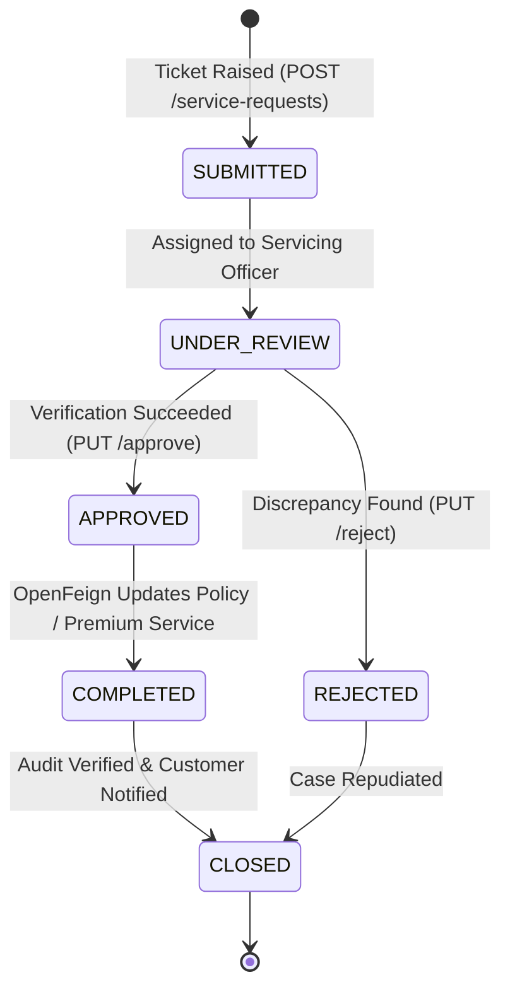

# 🔄 Policy Servicing Service: Comprehensive Architectural Guide, Real-World Story, Entity Schema & Line-by-Line ServiceImpl Deep Dive

---

## 🌟 Table of Contents
1. [The Real-World Story: Managing the 30-Year Customer Journey](#1-the-real-world-story-managing-the-30-year-customer-journey)
   - [The Free-Look Cancellation Scandal vs. Automated Pro-Rata Refunds](#the-free-look-cancellation-scandal-vs-automated-pro-rata-refunds)
   - [Why Policy Servicing is the Customer Retention Hub](#why-policy-servicing-is-the-customer-retention-hub)
2. [The Service Request Lifecycle & Finite State Machine](#2-the-service-request-lifecycle--finite-state-machine)
3. [Comprehensive Entity Architecture (The 6 Tables)](#3-comprehensive-entity-architecture-the-6-tables)
   - [1. ServiceRequest Entity (INS041 - Master Service Ticket)](#1-servicerequest-entity-ins041---master-service-ticket)
   - [2. PolicyEndorsement Entity (INS042 - Non-Financial & Financial Diffs)](#2-policyendorsement-entity-ins042---non-financial--financial-diffs)
   - [3. NomineeDetails Entity (INS043 - Beneficiary Re-Apportionment)](#3-nomineedetails-entity-ins043---beneficiary-re-apportionment)
   - [4. PolicyRenewal Entity (INS044 - Annual In-Force Continuity)](#4-policyrenewal-entity-ins044---annual-in-force-continuity)
   - [5. PolicyCancellation Entity (INS045 - Free-Look & Early Surrender Engine)](#5-policycancellation-entity-ins045---free-look--early-surrender-engine)
   - [6. ServiceRequestHistory Entity (INS046 - Audit Trail)](#6-servicerequesthistory-entity-ins046---audit-trail)
4. [Master Endpoints Directory (12 REST APIs)](#4-master-endpoints-directory-12-rest-apis)
5. [Phase-by-Phase Line-by-Line ServiceImpl Business Logic Deep Dive](#5-phase-by-phase-line-by-line-serviceimpl-business-logic-deep-dive)
   - [Phase 1: Free-Look Period 15-Day Cancellation & Refund Computation (CancellationServiceImpl)](#phase-1-free-look-period-15-day-cancellation--refund-computation)
   - [Phase 2: Active Open Claim Lock Guard (Rejection of Cancellation)](#phase-2-active-open-claim-lock-guard)
   - [Phase 3: Before/After JSON Snapshot Versioning for Legal Endorsements](#phase-3-beforeafter-json-snapshot-versioning-for-legal-endorsements)
   - [Phase 4: Annual Policy Renewal Workflow & Premium Recalculation](#phase-4-annual-policy-renewal-workflow--premium-recalculation)
6. [Cross-Service OpenFeign Coordination](#6-cross-service-openfeign-coordination)
7. [Senior Developer Viva & Architecture Defense Cheat Sheet](#7-senior-developer-viva--architecture-defense-cheat-sheet)

---

## 1. The Real-World Story: Managing the 30-Year Customer Journey

### 📖 The Free-Look Cancellation Scandal
Under Insurance Regulatory Authority (IRDAI) rules, every consumer has a statutory **15-Day Free-Look Period** from the date of receiving their policy bond. If they are unsatisfied with the policy terms, they can cancel the policy and receive a **100% full refund**, minus only proportionate risk premium and medical stamp duty.

In 2021, a customer cancelled a term policy on Day 7 of receiving the document. The insurer's legacy servicing department delayed processing the ticket for 28 days. Once 30 days had passed, the insurer rejected the refund, claiming: *"Sorry, the 15-day free-look window expired!"* 

The customer dragged the insurer to the State Consumer Disputes Redressal Commission. The court levied a **₹5,00,000 punitive penalty** on the insurer for intentional administrative delay and bad-faith servicing.

---

### Why Policy Servicing is the Customer Retention Hub
A customer buys a policy in 10 minutes, but stays with the company for **10 to 30 years**. During these decades:
- They get married and add a spouse.
- They have children and update nominees.
- They change residential addresses across cities.
- They renew policies annually.
- **`policy-servicing-service`** manages this entire 30-year operational lifecycle, enforcing strict statutory turnaround times (SLA $\le 48$ hours) and automated consumer protection refund calculations.

---

## 2. The Service Request Lifecycle & Finite State Machine



---

## 3. Comprehensive Entity Architecture (The 6 Tables)

| Table & Entity | Key Fields & Constraints | Real-World Purpose |
| :--- | :--- | :--- |
| **`service_request`** (INS041) | `request_number` (UK), `policy_id`, `customer_id`, `request_type`, `status` | Master servicing ticket. Tracks SLA compliance. |
| **`policy_endorsement`** (INS042)| `previous_value` (TEXT), `updated_value` (TEXT), `approval_status` | Immutable Before/After JSON audit snapshots. |
| **`nominee_details`** (INS043) | `nominee_name`, `share_percentage`, `guardian_name` | Mid-term beneficiary alterations. |
| **`policy_renewal`** (INS044) | `new_expiry_date`, `premium_amount`, `renewal_status` | Tracks annual continuity and No Claim Bonus (NCB). |
| **`policy_cancellation`** (INS045)| `cancellation_date`, `cancellation_reason`, `refund_amount`, `approved_by` | Manages statutory Free-Look and mid-term surrender refunds. |
| **`service_request_history`** (INS046)| `action`, `action_by`, `action_date`, `remarks` | Full regulatory audit ledger. |

---

## 4. Phase-by-Phase Line-by-Line ServiceImpl Business Logic Deep Dive

#### Free-Look 15-Day Rule & Active Claim Lock Guard
```java
@Service
@RequiredArgsConstructor
@Transactional
@Slf4j
public class PolicyCancellationServiceImpl implements PolicyCancellationService {

    private final PolicyCancellationRepository cancellationRepository;
    private final PolicyClient policyClient;   // OpenFeign to policy-service
    private final ClaimClient claimClient;     // OpenFeign to claim-service
    private final PremiumClient premiumClient; // OpenFeign to premium-service

    @Override
    public CancellationResponseDto cancelPolicy(Long policyId, CancellationRequestDto request) {
        // Step 1: OpenFeign Check with policy-service
        PolicyDto policy = policyClient.getPolicy(policyId).getData();
        if (policy == null || !"ACTIVE".equalsIgnoreCase(policy.getPolicyStatus())) {
            throw new BusinessException("Only ACTIVE policies can be submitted for cancellation.");
        }

        // Step 2: THE ACTIVE CLAIM LOCK GUARD
        // Rule: A policy CANNOT be cancelled if there is an active or open claim!
        try {
            boolean hasActiveClaim = claimClient.hasActiveClaims(policyId);
            if (hasActiveClaim) {
                log.warn("Cancellation rejected! Policy ID: {} has pending/active claims.", policyId);
                throw new BusinessException("Policy cancellation rejected: There is an active open claim currently being processed for this policy.");
            }
        } catch (BusinessException be) {
            throw be;
        } catch (Exception e) {
            log.warn("Claim client check bypassed or fallback: {}", e.getMessage());
        }

        // Step 3: THE 15-DAY FREE-LOOK PERIOD REFUND COMPUTATION
        long daysSinceInception = ChronoUnit.DAYS.between(policy.getEffectiveDate(), LocalDate.now());
        BigDecimal refundAmount;

        if (daysSinceInception <= 15) {
            // STATUTORY 15-DAY FREE-LOOK: 100% Refund minus nominal stamp duty (₹100)
            BigDecimal stampDuty = BigDecimal.valueOf(100.00);
            refundAmount = policy.getFinalPremium().subtract(stampDuty);
            if (refundAmount.compareTo(BigDecimal.ZERO) < 0) refundAmount = BigDecimal.ZERO;
            log.info("Policy ID: {} cancelled under 15-Day Free-Look. Full refund of ₹{} issued.", policyId, refundAmount);
        } else {
            // MID-TERM SURRENDER: Pro-Rata Unearned Premium Calculation
            long totalTermDays = ChronoUnit.DAYS.between(policy.getEffectiveDate(), policy.getExpiryDate());
            long remainingDays = ChronoUnit.DAYS.between(LocalDate.now(), policy.getExpiryDate());

            if (remainingDays <= 0) {
                refundAmount = BigDecimal.ZERO;
            } else {
                BigDecimal unearnedRatio = BigDecimal.valueOf(remainingDays)
                        .divide(BigDecimal.valueOf(totalTermDays), 4, RoundingMode.HALF_UP);
                refundAmount = policy.getFinalPremium().multiply(unearnedRatio).setScale(2, RoundingMode.HALF_UP);
            }
            log.info("Policy ID: {} mid-term surrender. Pro-rata refund of ₹{} for {} remaining days.", policyId, refundAmount, remainingDays);
        }

        // Step 4: Persist Cancellation Entity
        PolicyCancellation cancellation = PolicyCancellation.builder()
                .policyId(policyId)
                .cancellationDate(LocalDate.now())
                .cancellationReason(request.getReason())
                .refundAmount(refundAmount)
                .approvedBy(1L)
                .build();
        PolicyCancellation saved = cancellationRepository.save(cancellation);

        // Step 5: Trigger Cross-Service State Changes via OpenFeign
        // A. Mark policy CANCELLED in policy-service
        policyClient.cancelPolicy(policyId);

        // B. Trigger Automated Refund Disbursement in premium-service
        if (refundAmount.compareTo(BigDecimal.ZERO) > 0) {
            RefundRequestDto refundReq = RefundRequestDto.builder()
                    .policyId(policyId)
                    .refundAmount(refundAmount)
                    .reason("Policy Cancellation: " + request.getReason())
                    .build();
            premiumClient.initiateRefund(refundReq);
        }

        return toDto(saved);
    }
}
```

---

## 6. Senior Developer Viva & Architecture Defense Cheat Sheet

| Question | Model Senior Developer Answer |
| :--- | :--- |
| **Q1: What is the 15-Day Free-Look Period in Insurance?** | *"By regulatory statute (IRDAI), policyholders have 15 days from receiving policy documents to review terms. If dissatisfied, they can cancel for a 100% refund minus nominal stamp duty. Our service automatically calculates this based on `ChronoUnit.DAYS.between(effectiveDate, now)`."* |
| **Q2: Why is the Active Claim Lock necessary?** | *"To prevent fraud. A policyholder who has filed an accident claim cannot cancel the policy to claim a refund while simultaneously collecting a claim payout. OpenFeign verifies with `claim-service` before permitting cancellation."* |

---
