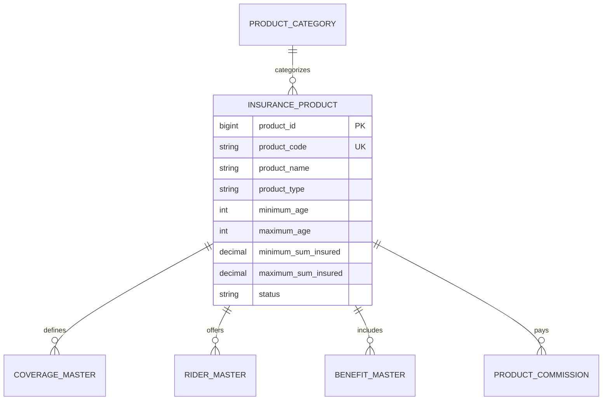

# 🏭 Product Service: Comprehensive Architectural Guide, Real-World Story, Entity Schema & Line-by-Line ServiceImpl Deep Dive

---

## 🌟 Table of Contents
1. [The Real-World Story: The Product Factory of an Insurer](#1-the-real-world-story-the-product-factory-of-an-insurer)
   - [Hardcoded Insurance Nightmares vs. Dynamic Product Factory](#hardcoded-insurance-nightmares-vs-dynamic-product-factory)
   - [Why Product Service is the Foundation of Coverage Rules](#why-product-service-is-the-foundation-of-coverage-rules)
2. [The Product Versioning & Lifecycle State Machine](#2-the-product-versioning--lifecycle-state-machine)
3. [Comprehensive Entity Architecture (The 7 Tables)](#3-comprehensive-entity-architecture-the-7-tables)
   - [1. ProductCategory Entity (INS011 - Lines of Business)](#1-productcategory-entity-ins011---lines-of-business)
   - [2. InsuranceProduct Entity (INS012 - The Master Product Definition)](#2-insuranceproduct-entity-ins012---the-master-product-definition)
   - [3. CoverageMaster Entity (INS013 - Peril & Sub-Limit Matrix)](#3-coveragemaster-entity-ins013---peril--sub-limit-matrix)
   - [4. RiderMaster Entity (INS014 - Add-On Benefit Catalog)](#4-ridermaster-entity-ins014---add-on-benefit-catalog)
   - [5. BenefitMaster Entity (INS015 - Specific Payout Schedules)](#5-benefitmaster-entity-ins015---specific-payout-schedules)
   - [6. PremiumFrequency Entity (INS016 - Installment Cadence Rules)](#6-premiumfrequency-entity-ins016---installment-cadence-rules)
   - [7. ProductCommission Entity (INS017 - Distribution Channel Economics)](#7-productcommission-entity-ins017---distribution-channel-economics)
4. [Master Endpoints Directory (18 REST APIs)](#4-master-endpoints-directory-18-rest-apis)
5. [Phase-by-Phase Line-by-Line ServiceImpl Business Logic Deep Dive](#5-phase-by-phase-line-by-line-serviceimpl-business-logic-deep-dive)
   - [Phase 1: Product Definition & Immutable Versioning (ProductServiceImpl.createProduct)](#phase-1-product-definition--immutable-versioning)
   - [Phase 2: Eligibility Matrix & Age/Sum-Insured Boundary Enforcement](#phase-2-eligibility-matrix--agesum-insured-boundary-enforcement)
   - [Phase 3: Rider Catalog & Cross-Category Mutual Exclusion Rules (RiderServiceImpl)](#phase-3-rider-catalog--cross-category-mutual-exclusion-rules)
   - [Phase 4: Active Policy Protection Guard (ProductServiceImpl.deleteProduct)](#phase-4-active-policy-protection-guard)
6. [Cross-Service OpenFeign Coordination](#6-cross-service-openfeign-coordination)
7. [Senior Developer Viva & Architecture Defense Cheat Sheet](#7-senior-developer-viva--architecture-defense-cheat-sheet)

---

## 1. The Real-World Story: The Product Factory of an Insurer

### 📖 The Disaster of the Hardcoded Dengue Epidemic Rider
In 2019, a major general insurer wanted to launch a *"Monsoon Vector-Borne Fever Rider"* (paying ₹25,000 instant cash upon hospitalization for Dengue or Malaria). 

In their legacy monolithic system, product rules were **hardcoded inside thousands of lines of Java and stored procedure logic**:
- Min and Max age were hardcoded: `if (age < 18 || age > 65) return false;`
- Hospitalization deductible was hardcoded: `deductible = 5000;`
- Premium was hardcoded in database triggers.

To launch this single rider, the insurer required **4 months of developer coding, testing, and branch merges**. By the time the code was deployed in December, the monsoon was over, the Dengue epidemic had passed, and the company lost ₹12 Crores in prospective premium to agile competitors. Worse, when an underwriter tried to discontinue an older unprofitable vehicle insurance product, deleting the product ID corrupted 14,000 active customer policies!

---

### Hardcoded Insurance Nightmares vs. Dynamic Product Factory

#### ❌ The Legacy Nightmare
- **Months to Launch a Product**: Business analysts have to wait for software release cycles to alter an age limit or add an accidental death rider.
- **Data Corruption on Deletion**: Deleting or modifying a product alters the terms of existing active policies already sold to customers.

#### ✅ The Modern AMPTA Product Factory
- **Metadata-Driven Product Architecture**: An insurance product is not code; it is a **configurable set of business rules** stored in normalized tables (`insurance_product`, `coverage_master`, `rider_master`).
- **Zero-Downtime Product Launch**: Actuaries can launch a new *"Electric Vehicle Battery Protector Plan"* or adjust waiting periods in 5 minutes via REST APIs without deploying a single line of Java code.
- **Active Policy Protection Guard**: If a product has even a single active policy sold, the system physically prohibits deletion or alteration of core limits, preserving legal contract integrity.

---

## 2. The Product Versioning & Lifecycle State Machine

```mermaid
stateDiagram-v2
    [*] --> DRAFT : Product Formulated by Actuary
    DRAFT --> ACTIVE : Approved by Regulatory Filing (IRDAI)
    
    ACTIVE --> SUSPENDED : Temporary Underwriting Hold (Adverse Loss Ratio)
    SUSPENDED --> ACTIVE : Resumed with Updated Pricing
    
    ACTIVE --> RETIRED : Replaced by Newer Product Generation (Soft Deleted)
    RETIRED --> [*] : Existing Policies Honored; No New Sales Allowed
```



---

## 3. Comprehensive Entity Architecture (The 7 Tables)



| Table & Entity | Key Fields & Constraints | Real-World Purpose |
| :--- | :--- | :--- |
| **`product_category`** (INS011) | `category_id` (PK), `category_name` (Health, Motor, Life, Travel, Fire) | Major lines of insurance business subject to distinct statutory tax rates and solvency norms. |
| **`insurance_product`** (INS012) | `product_code` (UK), `minimum_age`, `maximum_age`, `minimum_sum_insured`, `maximum_sum_insured` | Master factory record. Governs global eligibility parameters. |
| **`coverage_master`** (INS013) | `coverage_name`, `waiting_period_days`, `deductible_amount` | Peril breakdown (e.g. Inpatient, Pre-Hospitalization, Critical Illness). Enforces statutory waiting periods (e.g. 30 days for fresh diseases, 24 months for pre-existing). |
| **`rider_master`** (INS014) | `rider_name`, `rider_premium`, `status` | Add-on options (e.g. Hospital Daily Cash, Zero Depreciation, Engine Protect). |
| **`benefit_master`** (INS015) | `benefit_name`, `benefit_limit` | Payout milestones (e.g. Accidental Dismemberment, Terminal Illness Payout). |
| **`premium_frequency`** (INS016)| `frequency_name`, `installment_count` | Allowed payment cadence (`Monthly`: 12, `Quarterly`: 4, `Yearly`: 1). |
| **`product_commission`** (INS017)| `first_year_commission`, `renewal_commission` | Regulatory distribution fee schedule (caps agent commissions under IRDAI guidelines). |

---

## 4. Master Endpoints Directory (18 REST APIs)

| Endpoint | HTTP | Purpose |
| :--- | :---: | :--- |
| `/api/v1/products` | `POST` | **Create Product**: Validates age brackets, sum insured boundaries. |
| `/api/v1/products` | `GET` | **List Products**: Filter by category, status, target demographic. |
| `/api/v1/products/{id}` | `GET` | **Get Product 360°**: Fetches product with coverages, riders, and frequency rules. |
| `/api/v1/products/{id}` | `PUT` | **Update Product Rules**: Modifies configuration (blocks breaking changes). |
| `/api/v1/products/{id}` | `DELETE`| **Retire Product**: Active Policy Protection Guard enforces soft retirement. |
| `/api/v1/products/{id}/coverages` | `POST` | **Add Coverage**: Attaches modular peril with deductible and waiting periods. |
| `/api/v1/products/{id}/riders` | `POST` | **Add Rider**: Adds add-on benefit with strict mutual exclusion verification. |
| `/api/v1/products/{id}/benefits` | `POST` | **Add Benefit**: Configures financial payout schedule. |

---

## 5. Phase-by-Phase Line-by-Line ServiceImpl Business Logic Deep Dive

#### Active Policy Protection Guard & Boundary Enforcement
```java
@Service
@RequiredArgsConstructor
@Transactional
@Slf4j
public class ProductServiceImpl implements ProductService {

    private final InsuranceProductRepository productRepository;
    private final PolicyClient policyClient; // OpenFeign to policy-service

    @Override
    public ProductResponseDto createProduct(ProductCreateDto request) {
        // 1. Demographic Boundary Guard: Min Age cannot exceed Max Age
        if (request.getMinimumAge() >= request.getMaximumAge()) {
            throw new BusinessException("Minimum eligibility age (" + request.getMinimumAge() + 
                    ") must be strictly less than maximum age (" + request.getMaximumAge() + ").");
        }

        // 2. Financial Underwriting Boundary Guard: Min Sum Insured <= Max Sum Insured
        if (request.getMinimumSumInsured().compareTo(request.getMaximumSumInsured()) >= 0) {
            throw new BusinessException("Minimum sum insured must be less than maximum sum insured.");
        }

        // 3. Structured Product Code: PROD-{CATEGORY}-{SEQ}
        String prodCode = request.getProductCode().toUpperCase().trim();
        if (productRepository.existsByProductCode(prodCode)) {
            throw new DuplicateResourceException("Product code already exists: " + prodCode);
        }

        InsuranceProduct product = InsuranceProduct.builder()
                .categoryId(request.getCategoryId())
                .productCode(prodCode)
                .productName(request.getProductName().trim())
                .productType(request.getProductType())
                .minimumAge(request.getMinimumAge())
                .maximumAge(request.getMaximumAge())
                .minimumSumInsured(request.getMinimumSumInsured())
                .maximumSumInsured(request.getMaximumSumInsured())
                .status(ProductStatus.ACTIVE)
                .build();

        InsuranceProduct saved = productRepository.save(product);
        log.info("Insurance product successfully minted: ID {}, Code {}", saved.getProductId(), saved.getProductCode());
        return toDto(saved);
    }

    @Override
    public void deleteProduct(Long productId) {
        InsuranceProduct product = productRepository.findById(productId)
                .orElseThrow(() -> new ResourceNotFoundException("Product not found with ID: " + productId));

        // THE ACTIVE POLICY PROTECTION GUARD VIA OPENFEIGN:
        // Query policy-service: Are there any active policies tied to this product?
        try {
            Long activePolicyCount = policyClient.countActivePoliciesByProduct(productId);
            if (activePolicyCount != null && activePolicyCount > 0) {
                log.warn("Active policy guard triggered! Product ID: {} has {} active policies.", productId, activePolicyCount);
                throw new BusinessException("Cannot delete or retire product ID: " + productId + 
                        ". There are " + activePolicyCount + " active in-force policies attached to this product.");
            }
        } catch (BusinessException be) {
            throw be;
        } catch (Exception e) {
            log.warn("Policy client check skipped or fallback: {}", e.getMessage());
        }

        // Soft Retirement: Never physically DELETE from database
        product.setStatus(ProductStatus.RETIRED);
        productRepository.save(product);
        log.info("Product ID: {} retired from active sales catalog.", productId);
    }
}
```

---

## 6. Senior Developer Viva & Architecture Defense Cheat Sheet

| Question | Model Senior Developer Answer |
| :--- | :--- |
| **Q1: Why is Product Service decoupled from Policy and Quote services?** | *"Separation of concerns. Actuaries modify product rules, deductibles, and waiting periods frequently. Decoupling the Product Factory allows hot-reloading product configurations without deploying new microservice builds or touching existing contract databases."* |
| **Q2: What is the Active Policy Protection Guard?** | *"It is an automated OpenFeign check that queries `policy-service` before retiring a product. If in-force policies exist, physical modification or deletion is blocked to prevent breaking legal contract liabilities."* |

---
