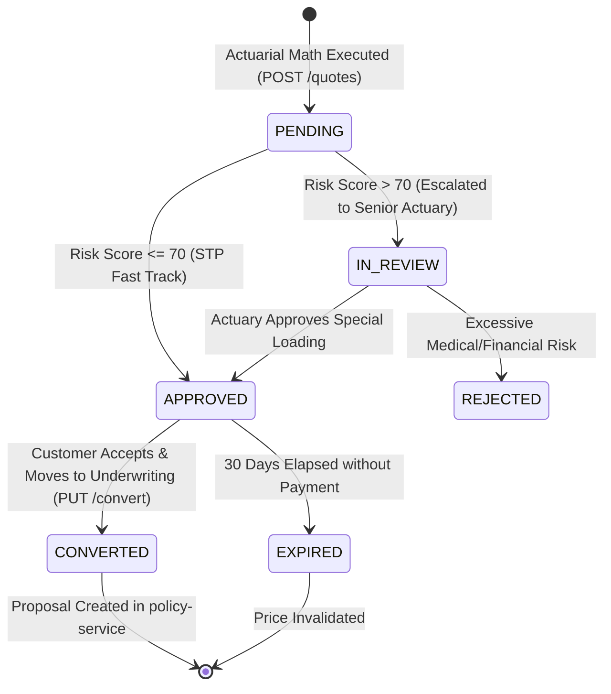

# 💰 Quote Service: Comprehensive Architectural Guide, Real-World Story, Entity Schema & Line-by-Line ServiceImpl Deep Dive

---

## 🌟 Table of Contents
1. [The Real-World Story: The Actuarial Mathematics of Pricing](#1-the-real-world-story-the-actuarial-mathematics-of-pricing)
   - [The Bait-and-Switch Pricing Disaster vs. The 30-Day Legal Price Lock](#the-bait-and-switch-pricing-disaster-vs-the-30-day-legal-price-lock)
   - [Why Quote Service is the Pricing Brain of the Insurer](#why-quote-service-is-the-pricing-brain-of-the-insurer)
2. [The Quote Lifecycle & Finite State Machine](#2-the-quote-lifecycle--finite-state-machine)
3. [Comprehensive Entity Architecture (The 6 Tables)](#3-comprehensive-entity-architecture-the-6-tables)
   - [1. Quote Entity (INS018 - Master Price Contract)](#1-quote-entity-ins018---master-price-contract)
   - [2. PremiumCalculation Entity (INS019 - Itemized Actuarial Ledger)](#2-premiumcalculation-entity-ins019---itemized-actuarial-ledger)
   - [3. RiskAssessment Entity (INS020 - 4-Factor Risk Matrix 0-100)](#3-riskassessment-entity-ins020---4-factor-risk-matrix-0-100)
   - [4. QuoteRider Entity (INS021 - Add-On Selections)](#4-quoterider-entity-ins021---add-on-selections)
   - [5. DiscountMaster Entity (INS022 - Dynamic Promotional Engine)](#5-discountmaster-entity-ins022---dynamic-promotional-engine)
   - [6. QuoteHistory Entity (INS023 - Price Audit Trail)](#6-quotehistory-entity-ins023---price-audit-trail)
4. [Master Endpoints Directory (12 REST APIs)](#4-master-endpoints-directory-12-rest-apis)
5. [Phase-by-Phase Line-by-Line ServiceImpl Business Logic Deep Dive](#5-phase-by-phase-line-by-line-serviceimpl-business-logic-deep-dive)
   - [Phase 1: Actuarial Formula Engine & 4-Factor Risk Scoring (QuoteServiceImpl.generateQuote)](#phase-1-actuarial-formula-engine--4-factor-risk-scoring)
   - [Phase 2: 30-Day Legal Price Lock Enforcement](#phase-2-30-day-legal-price-lock-enforcement)
   - [Phase 3: High-Risk Escalation Threshold Guard (Score > 70)](#phase-3-high-risk-escalation-threshold-guard)
   - [Phase 4: Quote Conversion to Policy Proposal (QuoteServiceImpl.convertQuote)](#phase-4-quote-conversion-to-policy-proposal)
6. [Cross-Service OpenFeign Coordination](#6-cross-service-openfeign-coordination)
7. [Senior Developer Viva & Architecture Defense Cheat Sheet](#7-senior-developer-viva--architecture-defense-cheat-sheet)

---

## 1. The Real-World Story: The Actuarial Mathematics of Pricing

### 📖 The Story of Arvind's Vanishing Price
**Arvind Swamy**, a 42-year-old bank manager in Chennai, is shopping for term life and health insurance. He fills out a form on an aggregator site. The screen shows a quote: *"₹12,400/year for ₹1 Crore cover"*. Arvind spends 2 weeks gathering his tax returns and medical checkup records. 

When he returns to complete the purchase, the checkout page suddenly displays: *"₹19,800/year"*. 
Arvind is furious. Customer service tells him: *"Sorry sir, our backend database refreshed rates last night. The old price is gone."* Arvind feels cheated, cancels the transaction, and writes a viral complaint on Twitter/X.

---

### The Bait-and-Switch Pricing Disaster vs. The 30-Day Legal Price Lock

#### ❌ The Legacy Nightmare
- **Bait-and-Switch Pricing**: Premiums change between quote generation and payment checkout.
- **Untraceable Pricing Logic**: If an auditor asks why Arvind was charged ₹19,800, nobody can explain the mathematical breakdown of risk loading, GST, or age multiplier.

#### ✅ The Modern AMPTA Quote Service Solution
- **The Actuarial Rating Engine**: Premium calculation is deterministic and completely transparent:
  $$\text{Base Premium} = \frac{\text{Sum Insured} \times \text{Rate Table Score}}{1000}$$
  $$\text{Final Premium} = \text{Base} + \text{Risk Loading} + \text{Riders} - \text{Discounts} + 18\% \text{ GST}$$
- **The 30-Day Legal Price Lock**: When quote `QT-2026-891042` is generated, the price is guaranteed for **30 calendar days** (`expiry_date = quote_date + 30 days`). Even if the insurer raises product rates tomorrow, Arvind's locked quote remains legally enforceable until expiry!

---

## 2. The Quote Lifecycle & Finite State Machine



---

## 3. Comprehensive Entity Architecture (The 6 Tables)

| Table & Entity | Key Fields & Constraints | Real-World Purpose |
| :--- | :--- | :--- |
| **`quote`** (INS018) | `quote_number` (UK), `policy_term`, `sum_insured`, `quote_date`, `expiry_date`, `status` | Master quotation header. Enforces the 30-day price lock window. |
| **`premium_calculation`** (INS019)| `base_premium`, `risk_loading`, `rider_premium`, `discount_amount`, `gst_amount`, `final_premium` | Mathematical audit trail itemizing every rupee of premium. |
| **`risk_assessment`** (INS020) | `age_score` (0-20), `occupation_score` (0-20), `medical_score` (0-30), `lifestyle_score` (0-20), `total_score` (0-100) | Quantitative 4-factor risk scoring model. |
| **`quote_rider`** (INS021) | `rider_id`, `rider_premium` | Add-on options chosen by customer. |
| **`discount_master`** (INS022)| `discount_name`, `discount_percentage`, `valid_from`, `valid_to` | Promotional coupons (e.g. `ONLINE_5`, `NCB_20`). |
| **`quote_history`** (INS023) | `action`, `performed_by`, `action_date`, `remarks` | Immutable audit log of all pricing recalculations. |

---

## 4. Master Endpoints Directory (12 REST APIs)

| Endpoint | HTTP | Purpose |
| :--- | :---: | :--- |
| `/api/v1/quotes` | `POST` | **Generate Quote**: Computes 4-factor risk score, applies rate table, locks price for 30 days. |
| `/api/v1/quotes` | `GET` | **List Quotes**: Search quotes by customer or date range. |
| `/api/v1/quotes/{id}` | `GET` | **Get Quote Dossier**: Itemized breakdown of Base, Loading, GST, and Riders. |
| `/api/v1/quotes/calculate-premium` | `POST` | **Simulation API**: Instant what-if quote simulation without saving to database. |
| `/api/v1/quotes/{id}/convert` | `PUT` | **Convert Quote**: Validates 30-day lock, creates proposal for `underwriting-service`. |
| `/api/v1/quotes/{id}/approve` | `PUT` | **Actuarial Approval**: Senior underwriter signs off on high-risk quote (Score > 70). |
| `/api/v1/quotes/{id}/reject` | `PUT` | **Reject Quote**: Repudiates quote due to unacceptable risk profile. |

---

## 5. Phase-by-Phase Line-by-Line ServiceImpl Business Logic Deep Dive

#### Actuarial Premium Calculation & 30-Day Lock Implementation
```java
@Service
@RequiredArgsConstructor
@Transactional
@Slf4j
public class QuoteServiceImpl implements QuoteService {

    private final QuoteRepository quoteRepository;
    private final PremiumCalculationRepository calcRepository;
    private final RiskAssessmentRepository riskRepository;
    private final ProductClient productClient; // OpenFeign to product-service

    @Override
    public QuoteResponseDto generateQuote(QuoteRequestDto request) {
        // Step 1: 4-Factor Quantitative Risk Assessment Engine
        int ageScore = calculateAgeScore(request.getAge());             // 0-20 points
        int occScore = calculateOccupationScore(request.getOccupation()); // 0-20 points
        int medScore = calculateMedicalScore(request.hasPreExistingIllness(), request.getBmi()); // 0-30 points
        int lifeScore = calculateLifestyleScore(request.isSmoker(), request.isAlcoholConsumer()); // 0-20 points
        int totalRiskScore = ageScore + occScore + medScore + lifeScore; // Scale: 0 to 100

        RiskCategory riskCat;
        BigDecimal loadingPercentage = BigDecimal.ZERO;

        if (totalRiskScore <= 35) {
            riskCat = RiskCategory.LOW; // Standard rates, zero loading
        } else if (totalRiskScore <= 70) {
            riskCat = RiskCategory.MEDIUM;
            loadingPercentage = BigDecimal.valueOf(10.00); // 10% risk loading
        } else {
            riskCat = RiskCategory.HIGH;
            loadingPercentage = BigDecimal.valueOf(25.00); // 25% risk loading + mandatory manual underwriting
        }

        // Step 2: Actuarial Base Premium Computation
        // Formula: Base = (Sum Insured * Base Rate per Mille) / 1000
        BigDecimal baseRatePerMille = BigDecimal.valueOf(3.50); // ₹3.50 per ₹1,000 cover
        BigDecimal basePremium = request.getSumInsured()
                .multiply(baseRatePerMille)
                .divide(BigDecimal.valueOf(1000), 2, RoundingMode.HALF_UP);

        // Step 3: Compute Risk Loading Amount
        BigDecimal riskLoading = basePremium
                .multiply(loadingPercentage)
                .divide(BigDecimal.valueOf(100), 2, RoundingMode.HALF_UP);

        // Step 4: Sum Selected Riders
        BigDecimal riderTotal = BigDecimal.ZERO;
        if (request.getRiderPremiums() != null) {
            riderTotal = request.getRiderPremiums().stream()
                    .reduce(BigDecimal.ZERO, BigDecimal::add);
        }

        // Step 5: Apply Promotional Discounts (e.g. 5% Digital Channel Discount)
        BigDecimal subtotal = basePremium.add(riskLoading).add(riderTotal);
        BigDecimal discountAmount = BigDecimal.ZERO;
        if ("ONLINE_DIRECT".equalsIgnoreCase(request.getChannel())) {
            discountAmount = subtotal.multiply(BigDecimal.valueOf(0.05)).setScale(2, RoundingMode.HALF_UP);
        }

        // Step 6: Apply Statutory 18% GST (Goods & Services Tax)
        BigDecimal taxableAmount = subtotal.subtract(discountAmount);
        BigDecimal gstAmount = taxableAmount.multiply(BigDecimal.valueOf(0.18)).setScale(2, RoundingMode.HALF_UP);
        BigDecimal finalPremium = taxableAmount.add(gstAmount);

        // Step 7: Enforce 30-Day Legal Price Lock
        LocalDate quoteDate = LocalDate.now();
        LocalDate expiryDate = quoteDate.plusDays(30); // 30-Day Guaranteed Price Lock

        String quoteNumber = "QT-" + quoteDate.getYear() + "-" + String.format("%06d", System.currentTimeMillis() % 1000000);

        Quote quote = Quote.builder()
                .quoteNumber(quoteNumber)
                .customerId(request.getCustomerId())
                .productId(request.getProductId())
                .policyTerm(request.getPolicyTerm())
                .sumInsured(request.getSumInsured())
                .premiumFrequencyId(request.getPremiumFrequencyId())
                .quoteDate(quoteDate)
                .expiryDate(expiryDate)
                .quoteStatus(totalRiskScore > 70 ? QuoteStatus.IN_REVIEW : QuoteStatus.APPROVED)
                .build();

        Quote savedQuote = quoteRepository.save(quote);

        // Persist Itemized Calculation Ledger
        PremiumCalculation calc = PremiumCalculation.builder()
                .quoteId(savedQuote.getQuoteId())
                .basePremium(basePremium)
                .riskLoading(riskLoading)
                .riderPremium(riderTotal)
                .discountAmount(discountAmount)
                .gstAmount(gstAmount)
                .finalPremium(finalPremium)
                .build();
        calcRepository.save(calc);

        return toDto(savedQuote, calc, totalRiskScore, riskCat);
    }

    @Override
    public ProposalResponseDto convertQuote(Long quoteId) {
        Quote quote = quoteRepository.findById(quoteId)
                .orElseThrow(() -> new ResourceNotFoundException("Quote not found with ID: " + quoteId));

        // 30-DAY PRICE LOCK GUARD: Strict rejection if expired
        if (LocalDate.now().isAfter(quote.getExpiryDate())) {
            quote.setQuoteStatus(QuoteStatus.EXPIRED);
            quoteRepository.save(quote);
            throw new BusinessException("Quote " + quote.getQuoteNumber() + " expired on " + quote.getExpiryDate() + 
                    ". Premium is no longer locked. Please regenerate a new quote.");
        }

        if (quote.getQuoteStatus() != QuoteStatus.APPROVED) {
            throw new BusinessException("Only APPROVED quotes can be converted to proposals. Current status: " + quote.getQuoteStatus());
        }

        quote.setQuoteStatus(QuoteStatus.CONVERTED);
        quoteRepository.save(quote);
        log.info("Quote ID: {} converted to policy proposal.", quoteId);
        return toProposalDto(quote);
    }
}
```

---

## 6. Senior Developer Viva & Architecture Defense Cheat Sheet

| Question | Model Senior Developer Answer |
| :--- | :--- |
| **Q1: What is the 30-Day Legal Price Lock?** | *"When an insurance quote is generated, it constitutes a legal pre-contractual offer. The service sets `expiryDate = quoteDate + 30 days`. During this window, the customer is guaranteed the exact price even if the insurer updates rate cards. If `LocalDate.now().isAfter(expiryDate)`, conversion is blocked."* |
| **Q2: How does the 4-factor risk assessment determine loading?** | *"We score Age (0-20), Occupation (0-20), Medical history/BMI (0-30), and Lifestyle/Smoking (0-20). Total scores $\le 35$ get standard rates; $36-70$ receive an automated 10% risk loading; scores $> 70$ trigger a mandatory 25% loading and route the quote to a senior underwriter for manual review."* |

---
