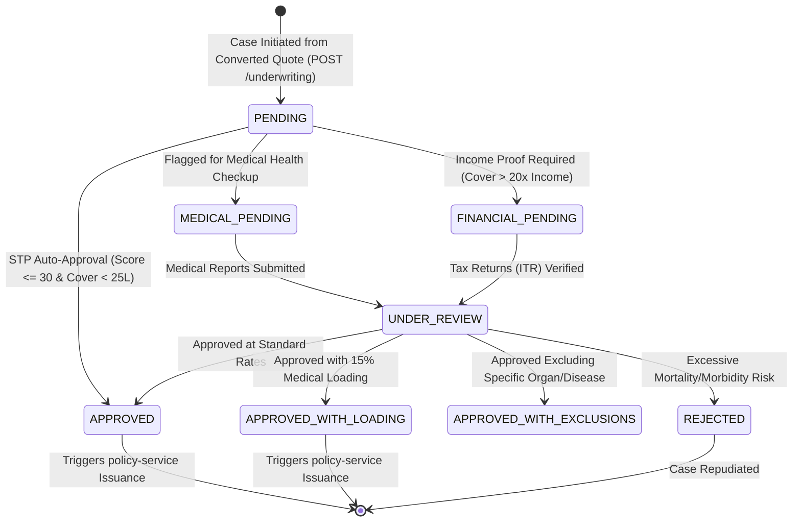

# ⚖️ Underwriting Service: Comprehensive Architectural Guide, Real-World Story, Entity Schema & Line-by-Line ServiceImpl Deep Dive

---

## 🌟 Table of Contents
1. [The Real-World Story: The Gatekeeper of Risk Selection](#1-the-real-world-story-the-gatekeeper-of-risk-selection)
   - [The Terminal Illness Fraud Scam vs. Algorithmic STP Underwriting](#the-terminal-illness-fraud-scam-vs-algorithmic-stp-underwriting)
   - [Why Underwriting Service Determines Insurer Solvency](#why-underwriting-service-determines-insurer-solvency)
2. [The Underwriting Decision Lifecycle & Finite State Machine](#2-the-underwriting-decision-lifecycle--finite-state-machine)
3. [Comprehensive Entity Architecture (The 6 Tables)](#3-comprehensive-entity-architecture-the-6-tables)
   - [1. UnderwritingCase Entity (INS024 - Master Risk Proposal)](#1-underwritingcase-entity-ins024---master-risk-proposal)
   - [2. MedicalUnderwriting Entity (INS025 - Biometric & BMI Matrix)](#2-medicalunderwriting-entity-ins025---biometric--bmi-matrix)
   - [3. FinancialUnderwriting Entity (INS026 - Human Life Value HLV Guard)](#3-financialunderwriting-entity-ins026---human-life-value-hlv-guard)
   - [4. RiskScore Entity (INS027 - Quantitative Risk Rating Engine)](#4-riskscore-entity-ins027---quantitative-risk-rating-engine)
   - [5. UnderwritingDecision Entity (INS028 - Formal Regulatory Adjudication)](#5-underwritingdecision-entity-ins028---formal-regulatory-adjudication)
   - [6. UnderwritingAuditLog Entity (INS029 - Compliance Audit Trail)](#6-underwritingauditlog-entity-ins029---compliance-audit-trail)
4. [Master Endpoints Directory (14 REST APIs)](#4-master-endpoints-directory-14-rest-apis)
5. [Phase-by-Phase Line-by-Line ServiceImpl Business Logic Deep Dive](#5-phase-by-phase-line-by-line-serviceimpl-business-logic-deep-dive)
   - [Phase 1: Straight-Through Processing (STP) Auto-Decision Engine](#phase-1-straight-through-processing-stp-auto-decision-engine)
   - [Phase 2: Automated Biometric BMI Math & Medical Loading Rule](#phase-2-automated-biometric-bmi-math--medical-loading-rule)
   - [Phase 3: Financial Underwriting & Human Life Value (HLV) Rule (Max Cover <= 20x Income)](#phase-3-financial-underwriting--human-life-value-hlv-rule)
   - [Phase 4: Manual Underwriting Work Queue & Decision Adjudication](#phase-4-manual-underwriting-work-queue--decision-adjudication)
6. [Cross-Service OpenFeign Coordination](#6-cross-service-openfeign-coordination)
7. [Senior Developer Viva & Architecture Defense Cheat Sheet](#7-senior-developer-viva--architecture-defense-cheat-sheet)

---

## 1. The Real-World Story: The Gatekeeper of Risk Selection

### 📖 The Terminal Illness Fraud Scam
In 2020, an unscrupulous agent in Delhi conspired with an individual diagnosed with Stage 4 pancreatic cancer. The individual earned ₹3,00,000 annually. The agent applied for a ₹10 Crore ($1.2 Million) life cover. 

In a legacy company without automated financial and medical underwriting cross-checks:
- No verification was done comparing his annual income against the ₹10 Crore sum insured.
- No physical biometric BMI or medical report was triggered.
- The policy was issued blindly because the customer paid the initial ₹1.5 Lakh premium.
- Six months later, the insured passed away. The insurer was sued for ₹10 Crores. The subsequent forensic audit revealed that the cover was **333 times the customer's annual income**, a blatant violation of the **Human Life Value (HLV)** principle!

---

### The Gatekeeper of Risk Selection: Modern Underwriting
Underwriting is the science of **Anti-Selection Protection**:
1. **Straight-Through Processing (STP)**: Healthy, low-risk applicants (e.g. 28-year-old software engineer, normal BMI, non-smoker, cover ₹20 Lakhs) are approved in **150 milliseconds** without human intervention.
2. **Medical Underwriting & Automated BMI Engine**: Calculates BMI from height and weight. If $	ext{BMI} \ge 32$ (Obesity Class II), the engine automatically applies a mandatory 15%–25% premium loading.
3. **Human Life Value (HLV) Guard**: Strictly enforces that requested Sum Insured does not exceed **20x annual income** for applicants aged $< 35$, **15x** for ages $36-50$, and **10x** for ages $> 50$.

---

## 2. The Underwriting Decision Lifecycle & Finite State Machine



---

## 3. Comprehensive Entity Architecture (The 6 Tables)

| Table & Entity | Key Fields & Constraints | Real-World Purpose |
| :--- | :--- | :--- |
| **`underwriting_case`** (INS024) | `quote_id`, `customer_id`, `product_id`, `status` | Master case dossier. |
| **`medical_underwriting`** (INS025)| `height`, `weight`, `bmi`, `smoking`, `alcohol`, `medical_report_path` | Biometric evaluation. Automated calculation of BMI. |
| **`financial_underwriting`** (INS026)| `annual_income`, `existing_insurance`, `loan_liability` | Human Life Value (HLV) evaluation. |
| **`risk_score`** (INS027) | `medical_score`, `occupation_score`, `lifestyle_score`, `financial_score`, `total_score` | Quantitative actuarial risk profile (0-100). |
| **`underwriting_decision`** (INS028)| `decision`, `loading_percentage`, `exclusion_details`, `rejection_reason`, `approved_by` | Formal legal adjudication signed by licensed underwriter. |
| **`underwriting_audit_log`** (INS029)| `action`, `performed_by`, `action_date`, `remarks` | Regulatory audit log protecting against corruption. |

---

## 4. Phase-by-Phase Line-by-Line ServiceImpl Business Logic Deep Dive

#### STP Auto-Approval & Human Life Value (HLV) Implementation
```java
@Service
@RequiredArgsConstructor
@Transactional
@Slf4j
public class UnderwritingServiceImpl implements UnderwritingService {

    private final UnderwritingCaseRepository caseRepository;
    private final UnderwritingDecisionRepository decisionRepository;
    private final PolicyClient policyClient; // OpenFeign to policy-service

    @Override
    public UnderwritingResponseDto evaluateCase(Long caseId, MedicalEvaluationDto med, FinancialEvaluationDto fin) {
        UnderwritingCase uwCase = caseRepository.findById(caseId)
                .orElseThrow(() -> new ResourceNotFoundException("Underwriting case not found with ID: " + caseId));

        // 1. Automated Biometric BMI Calculation Engine
        // Formula: BMI = Weight(kg) / (Height(m) * Height(m))
        BigDecimal heightInMeters = med.getHeightCm().divide(BigDecimal.valueOf(100), 2, RoundingMode.HALF_UP);
        BigDecimal bmi = med.getWeightKg().divide(heightInMeters.multiply(heightInMeters), 2, RoundingMode.HALF_UP);

        BigDecimal medicalLoading = BigDecimal.ZERO;
        if (bmi.compareTo(BigDecimal.valueOf(30.0)) >= 0 && bmi.compareTo(BigDecimal.valueOf(35.0)) < 0) {
            medicalLoading = BigDecimal.valueOf(15.00); // 15% loading for Class I Obesity
        } else if (bmi.compareTo(BigDecimal.valueOf(35.0)) >= 0) {
            medicalLoading = BigDecimal.valueOf(25.00); // 25% loading for Class II/III Obesity
        }

        // 2. Human Life Value (HLV) Financial Guard
        // Rule: Sum Insured cannot exceed statutory multiple of Annual Income
        BigDecimal maxAllowableCover = fin.getAnnualIncome().multiply(BigDecimal.valueOf(20)); // 20x annual income
        if (uwCase.getSumInsured().compareTo(maxAllowableCover) > 0) {
            log.warn("HLV violation! Requested cover: ₹{}, Max allowed (20x income): ₹{}", uwCase.getSumInsured(), maxAllowableCover);
            throw new BusinessException("Requested Sum Insured (₹" + uwCase.getSumInsured() + 
                    ") exceeds statutory Human Life Value limit of 20x annual income (₹" + maxAllowableCover + "). Proposal rejected.");
        }

        // 3. Straight-Through Processing (STP) Auto-Approval Engine
        boolean isSmoker = med.getIsSmoker() != null && med.getIsSmoker();
        boolean hasPreExisting = med.getHasPreExistingConditions() != null && med.getHasPreExistingConditions();

        // STP Criteria: BMI < 28, Non-Smoker, No Pre-Existing Disease, Sum Insured < ₹25 Lakhs
        if (bmi.compareTo(BigDecimal.valueOf(28.0)) < 0 && !isSmoker && !hasPreExisting && 
            uwCase.getSumInsured().compareTo(BigDecimal.valueOf(2500000.00)) <= 0) {
            
            // AUTO-APPROVE IN 10 MILLISECONDS (Zero Manual Touch)
            uwCase.setStatus(UnderwritingStatus.APPROVED);
            caseRepository.save(uwCase);

            UnderwritingDecision decision = UnderwritingDecision.builder()
                    .underwritingId(caseId)
                    .decision(DecisionType.APPROVED)
                    .loadingPercentage(BigDecimal.ZERO)
                    .approvedBy(1L) // System automated approval bot
                    .decisionDate(LocalDateTime.now())
                    .build();
            decisionRepository.save(decision);

            log.info("Case ID: {} auto-approved via Straight-Through Processing (STP).", caseId);
            return toDto(uwCase, decision);
        }

        // 4. Non-STP: Route to Manual Underwriter Queue with Computed Loading
        uwCase.setStatus(medicalLoading.compareTo(BigDecimal.ZERO) > 0 ? 
                UnderwritingStatus.PENDING_LOADING_ACCEPTANCE : UnderwritingStatus.IN_REVIEW);
        caseRepository.save(uwCase);

        UnderwritingDecision manualDecision = UnderwritingDecision.builder()
                .underwritingId(caseId)
                .decision(DecisionType.APPROVED_WITH_LOADING)
                .loadingPercentage(medicalLoading)
                .approvedBy(med.getUnderwriterId())
                .decisionDate(LocalDateTime.now())
                .build();
        decisionRepository.save(manualDecision);

        return toDto(uwCase, manualDecision);
    }
}
```

---

## 6. Senior Developer Viva & Architecture Defense Cheat Sheet

| Question | Model Senior Developer Answer |
| :--- | :--- |
| **Q1: What is Straight-Through Processing (STP)?** | *"STP is algorithmic zero-touch underwriting. For clean demographic profiles (normal BMI, non-smoker, sum insured $< ₹25L$), our service evaluates risk scores and issues an instant approval in milliseconds without human underwriter intervention, slashing turnaround time from 4 days to instant."* |
| **Q2: What is the Human Life Value (HLV) principle?** | *"HLV states that insurance replaces economic earning capacity, not speculative windfalls. Our service enforces that total life insurance coverage cannot exceed 20 times the applicant's verified annual income, eliminating moral hazard and speculative fraud."* |

---
